# Explicit Kinematic Relations for Radar-Grounded Question Answering with Frozen Language Models

**M4Human Relational64** menguji apakah representasi gerak tubuh yang memisahkan translasi global, artikulasi lokal, dan relasi antarsendi membantu model bahasa menjawab pertanyaan kinematika dari radar mmWave. Studi ini menggunakan M4Human sebagai sumber data dan Qwen2.5-1.5B-Instruct sebagai model bahasa yang dibekukan.

## Abstrak

Fitur radar mentah dan koordinat tubuh absolut mencampur perpindahan seluruh tubuh dengan gerak anggota tubuh relatif terhadap badan. Penelitian ini menguji apakah menyajikan struktur gerak secara eksplisit sebelum tahap alignment ke model bahasa meningkatkan kualitas jawaban, setelah akses terhadap state fisik dan kapasitas projector dikendalikan.

Encoder radar memproses 64 frame point cloud XYZ+intensity. Kepala pose memprediksi 22 joint, lalu jalur relasional membentuk state global dan lokal serta deskriptor hubungan kinematik. Hasil fusi menjadi tepat 64 embedding sensor yang diproyeksikan ke Qwen beku. Evaluasi membandingkan representasi ini dengan kontrol state mentah, kontrol faktorisasi, kontrol edge eksplisit, baseline langsung, prior bahasa, aturan fisik, dan probe fitur.

Data M4Human aktual telah diaudit dan dipakai dalam eksekusi diagnostik bertahap di Windows/CUDA. Otoritas target joint, provenance koordinat RPC, dan sinkronisasi waktu paket lokal masih belum cukup untuk mengesahkan hasil ilmiah. Karena itu, seluruh angka diagnostik di repo ini merupakan bukti rekayasa dan belum mendukung kesimpulan akurasi atau hipotesis penelitian.

## Pertanyaan penelitian

- **RQ1:** Apakah representasi global/lokal dan relasi eksplisit meningkatkan QA dibanding kontrol pasangan state mentah dengan akses state dan kapasitas projector yang sama?
- **RQ2:** Apakah faktorisasi root/joint dan deskriptor edge memberi kontribusi yang dapat dibedakan?
- **RQ3:** Apakah jawaban bergantung pada bukti radar ketika sumber sensor diganti, dibanding prior bahasa atau label mayoritas?
- **RQ4:** Bagaimana galat estimasi fisik serta biaya memori dan waktu membatasi hasil?

Hipotesis utama membandingkan kondisi **R−S**. Prediksi tandingannya adalah galat pose dapat membesar ketika diturunkan menjadi kecepatan atau relasi, sehingga representasi eksplisit mungkin menurunkan kualitas jawaban. Penelitian menguji bentuk penyajian bukti kinematik; ia tidak menganggap pose, graph tubuh, supervisi kecepatan, atau model bahasa kecil sebagai kebaruan tunggal.

## Metode

| Komponen | Rancangan |
|---|---|
| Observasi | Jendela 64 frame; maksimum 150 titik/frame; kanal XYZ+intensity. Intensity tidak diperlakukan sebagai Doppler. |
| Encoder fisik | Encoder spasial-temporal berbasis mmMind dan kepala pose 22 joint dengan pelvis sebagai joint 0. |
| Kinematika | Posisi dan kecepatan prediksi radar; state akar global dan joint relatif; 29 relasi tubuh berupa 21 bone dan 8 relasi bilateral. |
| Alignment bahasa | Fusi relasional menjadi 64 embedding sensor, projector terstruktur, lalu Qwen2.5-1.5B-Instruct dengan seluruh parameter dibekukan. |
| Keluaran | Label QA terstruktur untuk tren kelajuan pelvis serta perbandingan kelajuan lengan dan kaki relatif terhadap pelvis. |

### Alur arsitektur

```mermaid
flowchart LR
    X[Point cloud radar<br/>64 × titik × XYZ + intensity<br/>mask dan timestamp]
    X --> ENC[Encoder spasial-temporal<br/>mmMind-based]
    ENC --> Y[Fitur radar Y<br/>64 × 256]
    Y --> POSE[Kepala pose]
    POSE --> P[Posisi prediksi P<br/>64 × 22 × 3]
    P --> DERIV[Turunan 7 titik<br/>berdasarkan timestamp]
    DERIV --> V[Kecepatan prediksi V]
    P --> DESC[Deskriptor kinematik<br/>node global/lokal<br/>dan 29 relasi tubuh]
    V --> DESC
    Y --> PROJ[Projector relasional<br/>gabungkan Y, node, dan edge]
    DESC --> PROJ
    PROJ --> H[Fusi sensor<br/>64 embedding]
    H --> SPLICE[Splicing embedding sensor<br/>dengan prompt dan pertanyaan]
    Q[Prompt dan pertanyaan QA] --> SPLICE
    SPLICE --> LLM[Qwen2.5-1.5B-Instruct<br/>parameter dibekukan]
    LLM --> A[Jawaban QA terstruktur]

    GT[Target pose ground truth<br/>untuk supervisi training] -.-> LOSS[Loss fisik pose]
    P -.-> LOSS
    A -.-> QALOSS[Loss alignment QA<br/>pada training]
```



Jalur utama menggambarkan kondisi R. Target pose hanya memberi supervisi pada training; inference membentuk posisi dan kecepatan dari radar. Kondisi M melewati projector relasional dengan pemetaan fitur radar langsung, sedangkan S/F/E mengubah representasi node atau edge sesuai tabel pembanding.

mmMind menjadi fondasi encoder, bukan protokol yang direproduksi persis. Adaptasi penelitian ini memakai point cloud dan joint M4Human, panjang jendela, serta backbone beku yang berbeda dari konfigurasi mmMind yang dirujuk. Seluruh klaim harus merujuk pada eksperimen M4Human dalam repo ini.

Encoder memakai seluruh jendela secara bidirectional. Pada waktu nominal 12 Hz, 64 timestamp memiliki rentang endpoint 63 interval atau 5,25 detik; angka tersebut belum menggantikan timestamp hasil sinkronisasi yang terukur. Sistem menjawab setelah jendela lengkap tersedia dan tidak mengklaim prediksi streaming kausal, forecasting, estimasi gaya/torsi, niat, atau diagnosis.

## Kondisi eksperimen

| Kondisi | Representasi | Fungsi dalam rancangan |
|---|---|---|
| M | Fitur encoder langsung ke projector sederhana | Pembanding sistem radar langsung bergaya mmMind |
| S | Node absolut dan pasangan state mentah | Kontrol utama akses state dan kapasitas |
| F | Root global dan joint relatif, edge mentah | Mengisolasi faktorisasi global/lokal |
| E | Node absolut, edge kinematik eksplisit | Mengisolasi deskriptor relasi |
| R | Root global dan joint relatif, edge eksplisit | Kondisi utama hipotesis |
| T, Maj | Qwen tanpa sensor dan mayoritas label train | Mengukur prior bahasa dan prior label |
| Rule, Probe | Aturan atas state prediksi dan classifier fitur | Mendiagnosis estimasi fisik dan keterbacaan fitur |

Projector S/F/E/R dirancang memiliki kapasitas trainable yang sama, jumlah embedding sensor sama, paparan QA dan protokol evaluasi yang sama. Perbandingan primer **R−S** menguji operasi kinematik eksplisit terhadap pasangan state mentah. **R−M** mengukur perubahan sistem secara keseluruhan karena akses state dan projector juga berubah; selisih tersebut tidak ditafsirkan sebagai efek tunggal relasi. Faktorial S/F/E/R memisahkan kontribusi faktorisasi dan edge.

## Protokol dan metrik

Split berdasarkan subjek menggunakan 12 subjek train, 4 validasi, dan 4 test dengan seed pembagian 42. Pemilihan model dan tuning hanya menggunakan train/validation. Kondisi dibandingkan pada panel QA yang sama; test dikunci sampai artefak dan checkpoint yang diperlukan memenuhi gerbang penelitian.

Endpoint primer adalah `S_atomic(R) − S_atomic(S)`, dengan `S_atomic = 0.50 × macro-F1_root + 0.25 × macro-F1_arms + 0.25 × macro-F1_legs`. Laporkan dukungan kelas, metrik per tugas, confusion matrix, validitas JSON/schema, coverage jawaban, dan interval ketidakpastian berkelompok menurut subjek. Pemeriksaan donor mengganti bukti radar sambil mempertahankan pertanyaan dan token teks, lalu menilai kebenaran kedua jawaban terhadap sumbernya masing-masing.

Evaluasi fisik mencakup global dan relative MPJPE, galat posisi pelvis, galat kecepatan absolut dan relatif, MAE kelajuan pelvis, serta MAE panjang tulang. Satuan posisi dilaporkan dalam meter dan milimeter; kecepatan dalam meter/detik. Ground truth hanya digunakan dalam loss dan evaluator yang dinyatakan; prediksi fisik menjadi masukan inference.

## Data dan batas validitas

Audit baru membaca 661.132 frame dari 20 subjek dan 324.850.904 titik. Payload tersimpan sebagai float32 `[N,4]` berkanal XYZ+intensity; jumlah titik aktual berkisar 85–1.435 per frame. Audit menemukan 993 pasangan subject/action dan 139 gap indeks. Angka ini merupakan inventaris paket yang diaudit; angka tersebut tidak disamakan diam-diam dengan 999 sekuens yang dilaporkan publikasi M4Human.

Pemeriksaan numerik transformasi kandidat dan visualisasi mendukung konsistensi aritmetika serta kelayakan spasial. Namun, bukti ini belum membuktikan bahwa `params.joints[:22]` setara dengan joint dari aset SMPL-X dan regressor otoritatif, belum menetapkan seluruh sumbu serta preprocessing RawPoints, dan belum memetakan key LMDB ke timestamp/recording sumber secara otoritatif. Waktu nominal 12 Hz masih provisional. Detail bukti dan artefak yang dibutuhkan untuk menutup batas tersebut ada di [otoritas data](docs/data_authority.md).

## Bukti yang tersedia

Pengujian software memakai fixture sintetis membuktikan jalur tensor, mask, loss, backward, pembekuan Qwen, splicing token, parser, dan metrik pada lingkungan Windows/CUDA. Pengujian tersebut bukan validasi ilmiah M4Human. Data aktual memang digunakan dalam eksekusi diagnostik di Windows/CUDA RTX 3060, dengan panel 8 window train dari 8 subjek dan 4 window validasi dari 4 subjek serta target/waktu provisional.

Tiga run awal menemukan generation tidak stabil. Run diagnostik keempat menghasilkan 12/12 keluaran yang valid menurut JSON/schema untuk masing-masing kondisi M/S/F/E/R pada panel validasi. Ini hanya mengukur keberhasilan format; ketepatan jawaban dan grounding belum dibuktikan. Run tersebut memakai gain embedding 0,026 sebagai varian diagnostik yang menyimpang dari spesifikasi H langsung, sehingga bukan konfigurasi penelitian yang telah dipilih. Model fisik menjalankan 20 update; penurunan loss dari 4,8554 ke 2,8641 belum memenuhi kriteria overfit yang direncanakan. Rincian dan kegagalan tiap tahap disimpan di [temuan diagnostik](docs/diagnostic_findings.md).

Belum ada hasil test ilmiah, akurasi yang diterima, ataupun bukti bahwa R mengungguli S. Gerbang target dan waktu G0 masih tertutup. Training penuh dijalankan sebagai pekerjaan eksperimen terpisah setelah authority dan konfigurasi ilmiah disahkan; eksekusi diagnostik tidak membuka label test dan tidak meluluskan gerbang itu.

## Reproduksibilitas

Lingkungan menggunakan Python 3.12, PyTorch standar, `.venv`/uv, dan lock dependensi Windows. Sumber dataset dan repo referensi bersifat read-only. Metadata, data turunan, laporan, dan checkpoint generasi aktif dibangun baru dan disimpan pada drive C di dalam repo ini. Konfigurasi menentukan lokasi output; [indeks artefak](ARTEFAK.md) mencatat bukti dan checkpoint yang tersedia.

Perintah berikut menjalankan pemeriksaan software serta laporan status dari root repo:

```powershell
& .\.venv\Scripts\python.exe -m relational64.cli verify --suite all
& .\.venv\Scripts\python.exe -m relational64.cli report
```

Untuk menjalankan atau melanjutkan eksperimen diagnostik bertahap dan membaca gerbang berikutnya, gunakan [runbook eksperimen](docs/runbook.md). Protokol, spesifikasi arsitektur, evaluasi, dan verifikasi yang menjadi dasar penelitian tercantum di [paket rancangan](docs/planning_relasi_kinematik/README.md). Keputusan desain yang memerlukan pengujian dirangkum dalam [catatan keputusan](docs/design_decisions.md).
