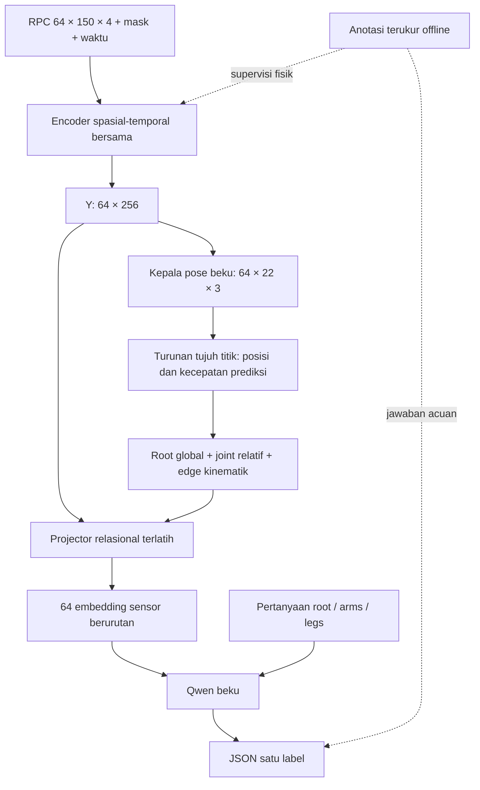

# Spesifikasi Penelitian Representasi Relasi Kinematik Radar

**Judul:** *Explicit Kinematic Relations for Radar-Grounded Question Answering with Frozen Language Models*  
**Protokol:** `m4human_relational64`  
**Tanggal:** 26 Oktober 2026  
**Status:** spesifikasi penelitian dan implementasi; bukan laporan hasil eksperimen.

Paket ini merupakan **source of truth** untuk sistem radar M4Human dengan observasi 64 frame, encoder berbasis mmMind, representasi relasi kinematik eksplisit, dan model bahasa berbobot tetap. Seluruh definisi operasional yang diperlukan untuk implementasi tersedia di dalam paket. Tautan pustaka berfungsi sebagai provenance ilmiah; pelaksana tidak perlu membuka pustaka untuk menentukan algoritme, dimensi, loss, pembagian data, atau evaluasi.

## Peta dokumen

| Dokumen | Isi normatif |
|---|---|
| [00 — Protokol ilmiah](00_protokol_ilmiah.md) | Hipotesis, pembanding, batas klaim, variabel yang dikendalikan |
| [01 — Data dan manifest](01_data_manifest.md) | Sumber, adapter, koordinat, split, normalisasi, window, provenance |
| [02 — Arsitektur](02_arsitektur.md) | Seluruh tensor, layer, relasi, kontrol, tokenisasi, jalur gradien |
| [03 — Target dan bahasa](03_target_bahasa.md) | Turunan waktu, label, ambiguitas, pertanyaan, jawaban, parsing |
| [04 — Pelatihan](04_pelatihan.md) | Objective, mask, optimizer, sampling, pembekuan, checkpoint |
| [05 — Evaluasi](05_evaluasi.md) | Metrik, ablasinya, donor, statistik, penguncian test, interpretasi |
| [06 — Kontrak implementasi](06_kontrak_implementasi.md) | Modul, API, format berkas, cache, perintah, urutan pekerjaan |
| [07 — Verifikasi dan penerimaan](07_verifikasi.md) | Contoh numerik, pengujian wajib, gerbang kelulusan |
| [08 — Perangkat dan operasional](08_perangkat_operasional.md) | RTX 3060, memori, profil, runtime, pelaporan, risiko |
| [Konfigurasi normatif](spesifikasi.yaml) | Nilai default yang dapat dibaca mesin; belum merupakan launcher training |

## Cara menggunakan spesifikasi

1. Penanggung jawab riset membaca 00, 03, dan 05 untuk mengunci pertanyaan ilmiah dan panel evaluasi.
2. Pelaksana data mengikuti 01 dan kontrak artefak 06 sebelum menyiapkan batch.
3. Pelaksana model mengikuti 02 dan 04. Semua perilaku yang tidak ditentukan oleh mmMind ditetapkan secara eksplisit dalam paket ini sebagai keputusan penelitian.
4. Pekerjaan diterima hanya melalui gerbang 07 pada lingkungan yang dinyatakan di 08.

**Wajib** berarti syarat validitas/implementasi. **Default** berarti nilai eksperimen utama yang dipakai apabila audit tidak menemukan masalah. **Ekstensi** berarti eksperimen terpisah, dengan ID kondisi tersendiri dan tidak dicampurkan ke endpoint primer.

Jika tabel, persamaan, dan konfigurasi tidak konsisten, pelaksana menghentikan tahap terkait dan membuat catatan inkonsistensi; tidak memilih nilai diam-diam. Nilai runtime diisi ke `runtime.lock.json`, lalu validator memeriksa konsistensinya terhadap paket ini. `null` pada konfigurasi menandakan fakta perangkat/data yang harus dibuktikan, bukan keleluasaan menentukan arsitektur.

## Keputusan inti

- Input utama: 64 **frame radar berurutan**, 150 titik maksimum per frame, kanal `x,y,z,intensity`; seluruh kondisi melihat dukungan sensor yang identik.
- Encoder bersama: lebar 256, tiga blok spasial, pooling query per frame, delapan blok temporal, empat attention head, FFN 1.024.
- Prediksi pose 22 joint dilatih menggunakan anotasi fisik. Setelah itu encoder dan kepala pose dibekukan.
- Kecepatan diturunkan dari posisi prediksi dengan estimator kuadratik tujuh titik dan waktu sensor. Tidak ada input pose GT pada inferensi.
- Representasi utama memisahkan gerak pelvis dari artikulasi relatif dan membentuk relasi bertipe pada 21 tulang dan delapan pasangan bilateral.
- Projector relasional belajar dari QA; encoder, kepala pose, dan Qwen tetap beku. Istilah **projector** mencakup MLP node, MLP edge, pooling, fusion, dan pemetaan embedding bahasa yang didefinisikan pada 02.
- Anggaran bahasa: tepat **64 embedding sensor** per window, satu per frame. Label frame, waktu, chat template, dan pertanyaan menambah token teks di luar 64 tersebut.
- Backbone utama: `Qwen/Qwen2.5-1.5B-Instruct`. `Qwen/Qwen3-8B` merupakan ekstensi terkontrol setelah kelayakan perangkat dibuktikan.
- Endpoint primer: selisih `S_atomic` antara representasi relasional dan kontrol state berkapasitas identik. Hasil negatif tetap merupakan hasil penelitian yang sah.

## Diagram sistem

## Fakta yang harus tersedia sebelum eksekusi

Lokasi dataset Windows, hasil inventaris LMDB, konvensi byte/sentinel, transformasi koordinat, asal timestamp, daftar subjek dan exposure, asset target, commit model/tokenizer, serta profil CUDA tidak dapat ditentukan dari nama dataset. Semuanya memiliki field, cara pemeriksaan, dan gerbang yang dijelaskan pada 01, 06, dan 08. Penulisan spesifikasi ini tidak mengesahkan keberadaan atau kualitas artefak tersebut.

Informasi dataset, perangkat, joint, dan task menggunakan [dokumen proposal M4Human](../../skripsi/proposal_sistem_penelitian_m4human_h64.md) sebagai sumber kebutuhan. Definisi implementasi untuk protokol `m4human_relational64` ditetapkan sepenuhnya dalam paket ini.
