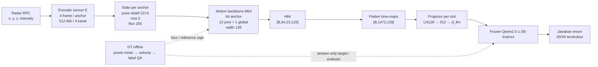

# Dokumen Induk Proposal dan Rancangan Sistem Penelitian H64

**Judul kerja:** *Sensor-Grounded Temporal Question Answering from Frozen Radar Motion Representations with a Frozen Language Model*  
**Judul Indonesia:** *Tanya Jawab Temporal Berlandaskan Sensor dari Representasi Gerak Radar Beku dengan Model Bahasa Beku*  
**Versi rancangan:** 1.0  
**Tanggal acuan:** 23 Oktober 2026  
**Revisi protokol:** `m4human_direct_h64_20261023_r1`  
**Kontrak sistem downstream:** `m4human_direct_h64_v1`

Dokumen ini menjadi naskah induk untuk menyusun proposal penelitian. Isinya merangkum masalah, landasan ilmiah, rancangan data, arsitektur, tujuan pelatihan, definisi label, evaluasi, dan batas klaim dalam satu tempat. Protokol yang diuraikan berfokus pada sistem H64 langsung dari representasi gerak radar ke model bahasa beku. Rancangan ini tidak mengajukan tahap kompresor atau token U.

Angka dan aturan yang dinyatakan di sini merupakan spesifikasi rancangan. Klaim tentang performa, keunggulan, optimalitas, generalisasi, keberhasilan implementasi, atau kelayakan perangkat hanya boleh ditulis setelah didukung hasil eksperimen yang sesuai. Isian yang memang harus dipilih melalui data train/validation disebutkan sebagai keputusan protokol, bukan diisi dengan angka rekaan.

---

## Ringkasan rancangan

Penelitian ini menguji apakah representasi gerak yang dibangun dari radar mmWave dapat menyimpan informasi posisi dan perubahan gerak yang cukup untuk menjawab pertanyaan temporal terstruktur, serta apakah model bahasa yang bobotnya dibekukan dapat menggunakan informasi sensor itu setelah hanya sebuah projector yang dilatih. Jalurnya adalah radar point cloud sequence, encoder sensor beku E, motion backbone M64, representasi H64, projector per slot, dan Qwen2.5-1.5B-Instruct yang beku.

M4Human menyediakan point cloud radar dan anotasi gerak terukur. Input bahasa dibatasi pada representasi sensor; RGB, bounding box, label aktivitas, target pose, serta mask kelayakan anotasi tidak menjadi fitur model. Target posisi dan velocity dipakai saat pelatihan fisik atau untuk membentuk jawaban acuan secara offline. Dengan pemisahan ini, kualitas pembacaan fisik, ketepatan jawaban QA, dan ketergantungan jawaban terhadap sensor dapat diukur sebagai tiga hal berbeda.

Jendela utama berisi 64 anchor berurutan. Setiap anchor mempertahankan konteks input E yang berisi empat frame, 512 titik dan empat kanal. Backbone M64 menghasilkan 64 langkah, 22 slot joint dan satu slot global berlebar 128. Semua 1.472 slot dialirkan ke projector tanpa pooling atau pengurangan slot. Projector dilatih untuk menyelaraskan prefix sensor dengan Qwen yang frozen. Tugas inti adalah tren kecepatan pelvis dan perbandingan gerak relatif anggota tubuh kiri-kanan untuk arms dan legs.

Penelitian menggunakan tiga pertanyaan utama: (1) apakah posisi, velocity, dan label kinematik tugas dapat dibaca dari H64 oleh estimator serta probe yang tidak menerima residual pose E; (2) apakah alignment projector-only memungkinkan Qwen beku menjawab QA atomik lebih baik daripada kontrol bahasa dan prior; dan (3) apakah jawaban yang dihasilkan mengikuti sumber radar pada pasangan donor dengan jawaban acuan yang berbeda. Grounding dievaluasi dengan mengganti masukan sensor sambil mempertahankan pertanyaan yang kompatibel, kemudian memeriksa kebenaran jawaban untuk kedua sumber.

Kontribusi yang dituju adalah rancangan pipeline radar-ke-QA temporal yang dapat diaudit, target kinematik dengan dukungan waktu dan mask eksplisit, serta protokol evaluasi yang memisahkan keterbacaan fisik, kualitas QA, dan penggunaan bukti sensor. Penelitian ini tidak mengklaim bahwa panjang 64 adalah optimum, bahwa model memahami fisika secara umum, atau bahwa projector, velocity supervision, radar-to-language, dan motion tokenization belum pernah diteliti.

**Kata kunci:** mmWave radar, M4Human, temporal question answering, kinematika, representasi gerak, frozen language model, sensor grounding.

---

## 1. Identitas dan alur argumentasi penelitian

### 1.1 Masalah ilmiah

Radar mmWave memungkinkan pengamatan manusia tanpa citra visual langsung dan dapat bekerja pada situasi ketika pencahayaan atau pandangan kamera terbatas. Namun, point cloud radar bersifat jarang dan berubah sepanjang waktu. Untuk pertanyaan seperti “apakah orang mempercepat?” atau “lengan mana yang bergerak lebih cepat?”, sistem perlu menghubungkan sinyal radar dengan posisi tubuh, menghitung perubahan gerak dari waktu, dan menyajikan hasil dalam bentuk jawaban bahasa yang dapat diperiksa.

Model bahasa dapat menghasilkan kalimat yang lancar karena pola bahasa atau prior tentang aktivitas, sekalipun masukan sensor tidak mendukung jawaban tersebut. Oleh sebab itu, akurasi pada sejumlah pertanyaan saja tidak cukup untuk menunjukkan bahwa sistem memakai bukti radar. Sebaliknya, keberhasilan estimator pose juga tidak otomatis menunjukkan bahwa representasi internal yang diberikan ke model bahasa masih memuat informasi kinematik yang relevan.

Masalah penelitian dirumuskan sebagai tiga pengujian terpisah:

1. **Keterbacaan fisik:** apakah keadaan gerak H64 dapat digunakan untuk memprediksi target posisi, root, velocity, dan kategori task kinematik?
2. **Kualitas QA:** apakah frozen language model yang diselaraskan melalui projector mampu memberi jawaban terstruktur yang cocok dengan target acuan?
3. **Grounding pada sensor:** ketika pertanyaan sama diberikan bersama representasi dari dua recording yang secara acuan memerlukan jawaban berbeda, apakah jawaban benar mengikuti masing-masing masukan radar?

Pemisahan ini merupakan prinsip metodologis utama. Kinerja M estimator yang menggunakan residual state dari E mengukur estimator dengan akses tambahan; ia tidak menggantikan probe H64 tanpa residual. Jawaban yang benar pada satu sampel tidak membuktikan pemakaian sensor; uji pasangan donor menilai hal itu secara lebih langsung.

### 1.2 Tujuan umum

Merancang dan mengevaluasi sistem tanya-jawab temporal berbasis radar yang:

- membentuk representasi gerak 64 anchor dengan identitas joint dan waktu;
- melatih motion backbone pada target fisik yang dinyatakan dalam satuan dan support waktu yang jelas;
- menyelaraskan representasi itu ke frozen Qwen melalui projector saja;
- menguji ketepatan fisik dan bahasa menggunakan split subject yang terpisah;
- mengukur apakah output berubah secara benar saat sumber sensor diganti dalam pasangan donor yang kompatibel.

### 1.3 Tujuan khusus

1. Mengonstruksi manifest jendela 64 anchor berbasis subject, recording, segmen, timestamp aktual, konteks empat frame, dan mask sensor.
2. Mengadaptasi backbone gerak menjadi M64 dengan keluaran H [B,64,23,128].
3. Menurunkan velocity dari anotasi posisi dengan estimator kuadratik kausal tujuh titik dan timestamp aktual.
4. Menyusun label QA atomik untuk tren kecepatan root dan perbandingan kecepatan anggota tubuh kiri-kanan.
5. Mengukur keterbacaan H64 melalui estimator fisik serta Probe_M yang tidak menerima residual E.
6. Melatih projector per slot sambil menjaga E, M64, physical heads, dan seluruh Qwen tetap beku.
7. Membandingkan QA H64 dengan kontrol teks/prior dan mengukur grounding H3 dengan pasangan donor.
8. Melaporkan cakupan, kegagalan parsing, dukungan kelas, ketidakpastian berbasis subject, serta biaya komputasi.

### 1.4 Pertanyaan penelitian

**RQ1 — Keterbacaan representasi:** Seberapa akurat posisi, root, velocity, serta kategori task kinematik dapat diprediksi dari H64? Bagaimana hasil probe baru tanpa residual E dibandingkan estimator yang memiliki akses residual?

**RQ2 — Alignment dan QA:** Seberapa baik projector-only alignment memungkinkan Qwen2.5-1.5B-Instruct yang frozen menjawab pertanyaan temporal atomik dari H64, dibandingkan frozen Qwen tanpa prefix sensor dan baseline prior berbasis label train?

**RQ3 — Grounding sensor:** Pada pasangan recording berbeda subject dan recording, dengan pertanyaan dan dukungan sensor yang cocok tetapi jawaban acuan berbeda, apakah jawaban model benar untuk kedua sumber setelah H diganti?

RQ1 menguji apa yang dapat dibaca dari representasi oleh keluarga estimator yang ditetapkan. RQ2 menguji performa QA pada task yang dibatasi. RQ3 menguji apakah jawaban mengikuti bukti masukan pada kelompok pasangan tertentu. Hasil tidak ditafsirkan sebagai ukuran seluruh informasi yang mungkin tersimpan di H atau sebagai bukti pemahaman fisika universal.

### 1.5 Hipotesis kerja

Hipotesis berikut adalah arah yang akan diuji, bukan pernyataan hasil.

- **H-PHYS:** H64 menyediakan informasi yang dapat dipakai oleh probe independen untuk memprediksi target posisi, velocity, dan kelas task kinematik di atas kontrol fisik sederhana pada populasi yang memenuhi dukungan target.
- **H-QA:** Prefix sensor H64 yang diselaraskan melalui projector memungkinkan frozen Qwen menghasilkan skor QA atomik lebih baik daripada kondisi text-only dan baseline TrainMajority pada cohort defined.
- **H-GROUND:** Pada pasangan donor reference-defined yang discordant dan kompatibel, model menghasilkan jawaban yang benar untuk kedua sumber lebih sering daripada kontrol yang hanya menggunakan prior bahasa atau distribusi kelas.

Hipotesis dinilai terpisah. Dukungan terhadap H-QA tidak dengan sendirinya mengesahkan H-PHYS; perubahan jawaban dalam H-GROUND tanpa correctness pada kedua sisi juga tidak cukup untuk mendukung grounding.

### 1.6 Batas ruang lingkup

Tugas inti P0 hanya mencakup:

- root_speed_trend: tren kecepatan global pelvis/root;
- relative_limb_motion untuk kelompok **arms**;
- relative_limb_motion untuk kelompok **legs**.

Penelitian tidak menjadikan pengenalan aktivitas umum, prediksi masa depan, urutan onset, biomekanika penuh, gaya/torsi, center of mass, diagnosis kesehatan, niat, percakapan bebas, atau causal mechanics sebagai target. QA komposisional bersifat sekunder dan memerlukan keputusan serta pemeriksaan reliability tersendiri sebelum test. Dua task atomik P0 tidak cukup untuk membuat klaim urutan peristiwa.

Istilah **H64** berarti representasi 64 langkah waktu; H64 bukan 64 token bahasa. Sebelum dimasukkan ke Qwen, 64 langkah × 23 slot menghasilkan alokasi 1.472 embedding slot.

---

## 2. Landasan teori dan posisi terhadap penelitian terdahulu

### 2.1 Radar dan representasi gerak manusia

M4Human merupakan benchmark multimodal untuk rekonstruksi mesh tubuh dari radar mmWave. Paper CVPR 2026 melaporkan 661 ribu frame, 20 subjek, 50 aktivitas, modalitas radar mentah dan point cloud terproses, serta anotasi motion-capture, mesh, dan trajectory global ([paper resmi CVF](https://openaccess.thecvf.com/content/CVPR2026/html/Fan_M4Human_A_Large-Scale_Multimodal_mmWave_Radar_Benchmark_for_Human_Mesh_CVPR_2026_paper.html)). Keragaman tersebut mendukung penggunaan dataset untuk mempelajari gerak, tetapi statistik paper tidak boleh diperlakukan sebagai jumlah sampel eksperimen yang independen: window berdekatan saling berkorelasi dan populasi lokal perlu didefinisikan dengan manifest.

Paper M4Human menggunakan klip skeleton 64 frame berurutan, sekitar lima detik, untuk benchmark HAR dari lintasan skeleton hasil estimasi. Penelitian ini memakai angka tersebut sebagai preseden skala temporal pada dataset yang sama, bukan sebagai bukti bahwa 64 adalah panjang optimal bagi QA kinematik atau H ([§10.5 paper M4Human](https://arxiv.org/html/2512.12378v3#S10.SS5)).

Radar point cloud bukan skeleton. Encoder sensor harus mengubah titik XYZ dan intensity menjadi representasi per anchor, sedangkan backbone temporal menghubungkan keadaan sepanjang jendela. Kalibrasi koordinat, identitas joint, timestamp, segmentasi recording, serta validitas point cloud menentukan apakah target yang diturunkan dapat ditafsirkan secara fisik.

### 2.2 Representasi spasial-temporal dan kinematika

Gerak manusia memiliki struktur spasial antar-joint dan temporal antar-frame. MotionBERT memperlihatkan penggunaan representasi skeleton spasial-temporal berbasis Dual-stream Spatio-temporal Transformer untuk tugas gerak, tetapi inputnya berupa observasi skeleton dan tidak sama dengan persepsi radar. Penelitian ini mengambil kebutuhan pemodelan joint-waktu sebagai landasan arsitektural, bukan klaim bahwa checkpoint atau metode MotionBERT dipakai.

Kecepatan tidak diasumsikan berasal langsung dari kanal intensity atau Doppler. Dalam rancangan ini, velocity dihitung dari trajectory posisi terhadap waktu. Pemisahan tersebut membuat makna besaran lebih jelas: posisi dinyatakan dalam meter, velocity dalam meter per detik, dan kecepatan pelvis merupakan norma vektor velocity. Estimator harus menggunakan timestamp aktual dan tidak menginterpolasi gap secara tersembunyi.

HuMoCon menunjukkan bahwa representasi motion understanding dapat memanfaatkan informasi velocity/perubahan gerak dan menjawab QA gerak. Karena itu, velocity supervision atau motion-to-QA bukan novelty tunggal penelitian ini. Perbedaannya terletak pada input radar M4Human, pembentukan H64 joint-waktu, frozen Qwen, task fisik yang didefinisikan dari target terukur, dan pengujian ketergantungan jawaban terhadap donor sensor.

### 2.3 Radar-to-language dan QA sensor

RadarLLM memperlihatkan jalur radar point-cloud sequence menuju pemahaman bahasa melalui radar tokenizer dan alignment modalitas. Studi tersebut membatasi klaim “radar pertama kali dipakai untuk bahasa” atau “radar baru dapat dipetakan ke token bahasa”. Fokus penelitian ini bukan membuktikan kemungkinan radar-to-language secara umum, tetapi menguji pertanyaan QA kinematik terstruktur menggunakan representasi temporal H64 dan LLM yang dibekukan.

LLaSA menghubungkan IMU dengan QA bahasa, namun studi itu mengadaptasi Vicuna menggunakan LoRA. Bobot dasar yang sebagian dibekukan pada LoRA tidak sama dengan kondisi penelitian ini, yang menjaga seluruh fungsi Qwen frozen dan hanya melatih projector. LLaSA juga menegaskan pentingnya membatasi klaim QA sesuai kualitas reference dan metode penilaiannya.

### 2.4 Frozen language model dan projector

MAPL merupakan preseden pemetaan ringan antara representasi model unimodal yang frozen untuk tugas vision-language. Ia memberi dasar konseptual bagi adapter kecil sebagai penghubung ruang representasi, tetapi domain gambar tidak membuktikan bahwa representasi gerak radar akan cocok dengan model bahasa. Penelitian ini menguji keselarasan tersebut langsung pada H64.

Bobot LLM yang frozen tidak membuat pembelajaran projector menjadi sekadar regresi tanpa jalur gradien. Saat training, Qwen harus menghitung gradien terhadap input embedding prefix agar parameter projector menerima sinyal loss. Parameter Qwen tetap tidak di-update, tetapi graph terhadap prefix sensor tetap aktif.

### 2.5 Tokenisasi, compression, dan batas novelty

MotionCtrl menggunakan part-aware motion tokens untuk generasi gerak, sehingga part-level representation bukan gagasan baru. SMC++ mempelajari kompresi video semantik dengan objective motion dan menguji tugas downstream termasuk QA video; hasilnya membatasi klaim umum bahwa informasi temporal atau motion-aware objective belum pernah dipakai untuk bahasa.

Walaupun karya tersebut relevan untuk tinjauan pustaka, desain aktif penelitian ini tidak membandingkan kompresor, tidak menghasilkan token U, dan tidak menguji retensi akibat kompresi. H64 mempertahankan slot waktu-joint secara langsung. Oleh karena itu, tinjauan pustaka harus memakai karya kompresi dan tokenisasi untuk menempatkan batas klaim, bukan menyiratkan bahwa penelitian aktif menguji keunggulan kompresi.

### 2.6 Rumusan gap penelitian yang defensibel

Literatur yang ditinjau telah mencakup radar-to-language, sensor-QA, representasi gerak joint-waktu, velocity-aware motion understanding, serta model bahasa frozen dengan penghubung ringan. Gap yang diuji di sini dirumuskan sebagai kebutuhan bukti pada **rangkaian kondisi yang spesifik**: representasi gerak 64 langkah yang dibangun dari RPC radar, target posisi/velocity yang memiliki support temporal eksplisit, alignment projector-only ke frozen LLM, QA kinematik berbentuk enum yang reference-defined, dan evaluasi sensor grounding melalui pasangan donor.

Rumusan yang disarankan:

> Penelitian terdahulu telah menunjukkan bahwa radar dapat dipetakan ke keluaran bahasa, bahwa representasi gerak dapat memanfaatkan informasi temporal dan velocity, dan bahwa model multimodal dapat dibangun dengan backbone bahasa yang dibekukan. Namun, performa QA pada satu sampel belum menunjukkan bahwa jawaban didasarkan pada bukti radar. Penelitian ini menguji keterbacaan target kinematik dari representasi gerak radar H64, kemampuan frozen language model menjawab QA atomik melalui projector-only alignment, dan ketepatan jawaban saat sumber sensor diganti pada pasangan donor yang kompatibel.

Gunakan “belum terjawab dalam protokol yang diuji” atau “belum menjadi bukti pada rangkaian kondisi ini”, bukan klaim absolut “belum pernah diteliti”. Audit literatur terarah tidak setara dengan systematic review yang menjamin seluruh karya relevan sudah ditemukan.

### 2.7 Matriks posisi penelitian terdahulu

| Karya | Modalitas dan keluaran | Relevansi terhadap rancangan | Batas perbandingan |
|---|---|---|---|
| M4Human, CVPR 2026 | Radar mmWave/RPC, RGB-D dan motion capture; benchmark body mesh, skeleton dan HAR | Dataset utama; mendukung motivasi dan target gerak terukur | Dataset paper tidak menentukan performa QA H64; hasil mesh/HAR bukan hasil penelitian ini |
| RadarLLM, AAAI 2026 | Urutan point cloud mmWave ke motion token dan bahasa | Preseden paling dekat untuk radar-to-language | Memakai tokenizer dan skema model yang berbeda; bukan bukti Probe_M H64 atau H3 donor |
| HuMoCon, CVPR 2025 | Motion/video representation dengan alignment serta velocity reconstruction untuk motion understanding/QA | Menunjukkan velocity-aware motion QA memiliki preseden | Bukan input radar; tidak sama dengan frozen Qwen projector-only |
| LLaSA, UbiComp Companion 2025 | IMU sensor ke QA bahasa melalui encoder/projector dan LLM yang diadaptasi | Preseden QA sensor | Menggunakan LoRA pada Vicuna; reference dan domain tugas berbeda |
| MAPL, EACL 2023 | Mapping ringan antara model vision dan language yang frozen | Landasan prinsip adapter/projector-only | Domain image-language, bukan gerak radar atau kinematika |
| MotionBERT, ICCV 2023 | Representasi skeleton spasial-temporal dengan DSTformer | Landasan pemodelan hubungan joint-waktu | Input skeleton/video pose, bukan point cloud radar; bukan checkpoint yang diasumsikan |
| MotionCtrl, ICCV 2025 | Part-aware motion tokens untuk generasi dan kontrol gerak | Membatasi klaim bahwa representasi part-level baru | Tujuan generasi/kontrol, bukan QA sensor kinematik |
| SMC++, TPAMI 2026 | Kompresi video semantik dan objective motion untuk downstream analysis termasuk QA | Membatasi klaim umum tentang motion-aware compression dan QA video | Video codec/reconstruction bukan H64 slot radar langsung ke frozen Qwen |

Tinjauan ini menjelaskan posisi metode dan batas klaim. Tabel tersebut tidak berarti setiap studi harus diimplementasikan sebagai baseline eksperimen.

---

## 3. Desain penelitian

### 3.1 Jenis penelitian

Penelitian merupakan eksperimen kuantitatif berbasis pembelajaran mesin dan evaluasi terkontrol. Komponen eksperimen dikelompokkan menurut pertanyaan ilmiah:

| Komponen | Pertanyaan yang dijawab | Unit bukti utama |
|---|---|---|
| Pembentukan target fisik | Apakah definisi posisi, velocity, support, dan kelas task dapat diturunkan secara konsisten dari target motion-capture? | Target kinematik, mask, audit recipe, dan cakupan |
| Motion backbone M64 | Apakah urutan radar dapat membentuk representasi spasial-temporal yang berguna untuk target fisik? | Error posisi/velocity dan loss validasi |
| Probe_M | Apakah informasi target dapat dibaca dari H64 tanpa residual E? | Error fisik dan skor task dari H64 saja |
| Alignment projector–Qwen | Apakah frozen Qwen dapat menghasilkan jawaban atomik dari prefix H64? | Macro-F1 kelas dan skor S_atomic |
| Grounding H3 | Apakah jawaban benar mengikuti sensor ketika H diganti pada pasangan discordant? | PairBothCorrect dan transisi jawaban |
| Resource/operasional | Apakah urutan konteks, komputasi, dan penggunaan memori dapat dijalankan tanpa mengubah definisi sistem? | Panjang token, VRAM/RAM, latency, parity, dan biaya evaluasi |

Tidak ada satu endpoint yang mewakili seluruh sistem. Klaim yang dihasilkan harus menyebut komponen dan populasi yang diukur.

### 3.2 Variabel dan konstruk

| Konstruk | Definisi operasional | Bukti |
|---|---|---|
| Input sensor | RPC berurutan dengan konteks 4 frame dan mask sensor | UID, timestamp, point mask, segment/recording |
| Representasi H64 | Tensor 64×23×128 dari exact-window M64 | Checkpoint M64, hash cache, mask, parity |
| Keterbacaan fisik | Prediksi target dari H oleh estimator/probe yang telah ditetapkan | MPJPE, root error, velocity error, task class |
| QA temporal | Prediksi enum JSON untuk query root/arms/legs | Parsing, macro-F1, S_atomic, support |
| Grounding sensor | Kebenaran respons pada pasangan donor discordant setelah H diganti | PairBothCorrect, sisi-per-sisi, coverage |
| Generalisasi | Performa pada subject yang tidak dipakai melatih model atau memilih threshold | Split subject dan test lock |
| Biaya | Context length, memori, waktu, throughput dan biaya full validation | Profil pada perangkat target |

### 3.3 Rancangan kontrol

- **H64:** kondisi utama; seluruh slot H64 melewati projector ke frozen Qwen.
- **L_text:** frozen Qwen dengan prompt/schema yang sama tanpa prefix sensor.
- **TrainMajority:** label mayoritas reference-defined pada data train untuk setiap task/subtype; aturan tie dikunci.
- **E_pose_D1:** derivative dari posisi E, sebagai kontrol fisik berbasis encoder.
- **M_estimator:** estimator fisik M yang boleh menggunakan residual posisi/root dari E.
- **M_refined_D1:** derivative dari posisi M refined, untuk membandingkan velocity terpelajar dan velocity hasil derivative posisi.
- **ZeroVelocity:** velocity nol pada support evaluasi yang sah; tidak memiliki endpoint posisi.
- **Probe_M:** probe fisik baru yang membaca H64 saja, tanpa residual E.

Kontrol-kontrol tersebut tidak memiliki kapasitas dan akses data yang identik. Perbandingan dipakai untuk menafsirkan sumber kemampuan, bukan sebagai estimasi kausal sempurna atas satu faktor. H64 dibanding L_text menguji manfaat prefix sensor dalam sistem ini; Probe_M dibanding estimator residual memisahkan keterbacaan H dari bantuan state E.

---

## 4. Sumber data, populasi, dan tata kelola sample

### 4.1 Dataset

Dataset utama adalah M4Human, benchmark radar mmWave dengan point cloud terproses dan anotasi gerak terukur. Paper dataset melaporkan sekitar 661 ribu frame, 999 sequence, 20 subject, 50 aktivitas, sinkronisasi sensor radar/RGB-D sekitar 12 Hz, serta data motion-capture dengan frekuensi lebih tinggi. Statistik tersebut mendeskripsikan benchmark publik; jumlah itu bukan jumlah window QA penelitian dan tidak sama dengan jumlah observasi independen.

Jalur sensor penelitian menggunakan RPC, bukan RGB, depth image, bounding box atau label aktivitas. Empat kanal yang diharapkan ialah x, y, z, dan intensity. Intensity tidak ditafsirkan sebagai Doppler, SNR, atau daya terkalibrasi tanpa bukti data yang sesuai. Target fisik berasal dari anotasi motion-capture yang ditransformasikan ke koordinat radar dengan unit meter dan joint map yang didefinisikan.

### 4.2 Populasi dan unit analisis

- **Unit akuisisi:** frame/anchor radar yang terkait recording dan subject.
- **Unit model:** satu jendela berisi 64 anchor berurutan.
- **Unit QA:** satu query untuk task dan body part pada satu jendela.
- **Unit independensi statistik utama:** subject; window yang overlap tidak dianggap sampel independen.
- **Unit grounding donor:** satu pasangan window dari dua subject/recording yang berbeda dengan query dan persyaratan sensor yang kompatibel.

Setiap window mempertahankan subject, recording, segmen, source frame IDs, ordered UIDs, timestamps, konteks E, mask sensor, dan hash policy. Window tidak boleh menyeberangi recording, perubahan segmen, gap temporal yang melanggar policy, atau batas split.

### 4.3 Split subject dan pencegahan kebocoran

Split harus dilakukan pada tingkat subject, sehingga seluruh recording, window, konteks input, serta dependency derivative suatu subject berada pada satu split. Daftar subject train, validation, dan test dikunci sebelum proses pemilihan model dan threshold. Test tidak dipakai untuk memilih checkpoint, prompt, recipe label, kelas, panjang konteks, donor policy, maupun hyperparameter.

Subject yang dipakai untuk mengkalibrasi ambang atau membuat label QA harus berasal dari train/validation. Jika evaluasi encoder sebelumnya pernah membuka test subject atau hasilnya pernah memengaruhi keputusan model/label, riwayat exposure dicatat dan interpretasi test disesuaikan. Banyak window dari sedikit subject tetap memiliki ukuran sampel efektif yang ditentukan subject, bukan jumlah window.

### 4.4 Kebijakan window H64

Untuk setiap segmen sensor kontigu dengan urutan source frame s0, s1, ..., anchor awal memakai phase segmen s0+3; posisi selanjutnya ditentukan dari indeks urutan dengan stride per split:

| Split | Stride antar-anchor awal window |
|---|---:|
| Train | 8 |
| Validation | 16 |
| Test | 16 |

Setiap anchor E membaca empat frame sesuai konteksnya. Phase di-reset pada segmen baru. Window yang tidak memiliki 64 anchor penuh dibuang; tidak ada padding pada ujung recording untuk membuat window baru. Missing GT tidak mengubah phase, stride, atau segmentasi sensor.

Observasi t0..t63 mengandung 64 timestamp dan 63 interval. Pada sampling nominal 12 Hz, rentang observasi sekitar 5,25 detik. Label velocity memakai endpoint t6..t63: enam anchor pertama adalah warm-up derivative, sehingga ada maksimum 58 endpoint kandidat. Query/task interval membentang 57 interval atau sekitar 4,75 detik nominal. Durasi aktual selalu dihitung dari timestamp, bukan diasumsikan tepat 12 Hz.

Minimum dukungan task core ialah 44 dari denominator tetap 58 endpoint, sesuai cakupan minimum 75%. Sensor context union dapat mencakup hingga 67 frame sumber karena konteks empat frame anchor pertama membutuhkan tiga frame sebelum anchor tersebut. Support observasi, support endpoint derivative, dan union konteks sensor adalah tiga himpunan berbeda dan harus dicatat terpisah.

### 4.5 Manifest dan integritas lineage

Manifest jendela menjadi referensi tunggal untuk trainer, cache, target, QA, evaluator, dan test lock. Isinya mencakup:

- window ID; split; subject; recording; segmen;
- 64 ordered anchor UID, source frame IDs, dan timestamp float64;
- sumber waktu dan time-base;
- 64×4 context UID untuk E;
- sensor masks serta union support;
- policy window, policy hash, dan alasan rejection;
- target support, derivative support, dan hash sumber koordinat/joint;
- hash source data, split, checkpoint E/M, normalizer, target recipe, dan QA.

Cache H menyimpan representasi exact-window. Tidak mengubah panjang cache lama dengan reshape, padding, concatenation, perubahan label revision, atau penggantian metadata. Exact-window forward memakai reset lokal sesuai kebijakan training.

---

## 5. Definisi kinematik dan pembentukan target QA

### 5.1 Koordinat dan peta tubuh

Ground truth menggunakan 22 joint dalam koordinat radar dan meter. Pelvis merupakan joint indeks 0. Slot global H indeks 22 adalah representasi agregat yang berbeda dari pelvis. Posisi pelvis/root ditargetkan secara terpisah. RGB, bbox, activity label, target kelas, dan annotation-validity mask tidak diteruskan ke model sensor maupun prefix bahasa.

Posisi joint relatif terhadap pelvis dan posisi root global disimpan secara terpisah. Pelvis pada posisi relatif memiliki nilai nol berdasarkan definisi, sehingga perhitungan MPJPE harus menjelaskan apakah pelvis relatif disertakan atau dikecualikan. Pelvis bukan center of mass dan label posisi pelvis tidak boleh disebut COM.

Target joint diturunkan dari anotasi gerak yang dapat dipertanggungjawabkan, ditransformasikan ke radar frame memakai kalibrasi yang sama, dan dinyatakan dalam meter. Untuk setiap timestamp, root adalah posisi joint pelvis; joint relatif dihitung sebagai posisi global joint dikurangi posisi pelvis. Parameter translasi body model tidak dianggap otomatis sebagai pelvis. Jika target diekspor melalui SMPL-X, versi asset, regressor, gender convention, parameter tubuh, transformasi dan provenance-nya dikunci.

Joint map 22 posisi yang dipakai sistem:

| Index | Nama | Index | Nama |
|---:|---|---:|---|
| 0 | pelvis | 11 | right_foot |
| 1 | left_hip | 12 | neck |
| 2 | right_hip | 13 | left_collar |
| 3 | spine1 | 14 | right_collar |
| 4 | left_knee | 15 | head |
| 5 | right_knee | 16 | left_shoulder |
| 6 | spine2 | 17 | right_shoulder |
| 7 | left_ankle | 18 | left_elbow |
| 8 | right_ankle | 19 | right_elbow |
| 9 | spine3 | 20 | left_wrist |
| 10 | left_foot | 21 | right_wrist |

Urutan ini juga menentukan joint slot M64 dan urutan output physical heads. Joint map, parent/edge list, pasangan kiri-kanan, sumber row index, satuan, transformasi koordinat, serta pelvis index harus konsisten di semua tahap.

### 5.2 Estimator velocity endpoint kausal tujuh titik

Untuk setiap endpoint e ≥ 6, ambil tujuh titik posisi trailing dari e−6 sampai e. Definisikan tau_i = time_i − time_e. Fit polinom kuadratik posisi terhadap waktu aktual. Recipe bersama bernama kinematic_recipe_h64_v1 dan menunjuk subrecipe derivative aligned12hz_endpoint_sg_v2:

$$
p(\tau)=\beta_0+\beta_1\tau+\beta_2\tau^2
$$

Velocity endpoint adalah beta_1; acceleration opsional 2 beta_2 tidak menjadi endpoint P0. Fit dihitung offline dengan presisi float64. Pada waktu seragam, urutan koefisien harus kronologis dan faktor dt diterapkan tepat sekali. Pada timestamp tidak seragam, fit memakai waktu aktual dan memeriksa rank serta conditioning.

Duplicate, nonmonotonic timestamp, gap yang melanggar policy, atau support annotation yang kurang membuat endpoint tidak sah. Gap tidak diisi melalui interpolasi tersembunyi. GT sebelum anchor pertama tidak dipakai untuk menutup warm-up.

### 5.3 Task root_speed_trend

Kecepatan pelvis/root pada endpoint e didefinisikan sebagai:

$$
speed_{root}(e)=\|v_{root}(e)\|_2
$$

Tren kecepatan dihitung dari seluruh pasangan endpoint yang sah dengan selisih waktu aktual. Estimator robust memakai median slope pasangan waktu-kecepatan; intercept median serta median absolute deviation (MAD) residual menjadi diagnostik kestabilan fit. Aturan deadband dan kriteria ambiguitas ditentukan dari train/validation, lalu dikunci sebelum test.

Label substantive:

- speeding_up: slope lebih besar dari deadband positif;
- slowing_down: slope lebih kecil dari deadband negatif;
- no_overall_trend: slope berada dalam deadband, dengan support dan kestabilan fit yang sah.

no_overall_trend tidak berarti kecepatan identik pada setiap endpoint. Fit ambigu dengan dukungan cukup diberi status unknown; dukungan atau audit target yang tidak cukup diberi undefined/excluded.

### 5.4 Task relative_limb_motion

Untuk setiap joint, gunakan magnitudo velocity root-relative. Perbandingan kiri-kanan dilakukan pada support anatomi berpasangan dan timestamp yang sama:

- **Arms:** kelompok elbow dan wrist kiri dibandingkan dengan kelompok elbow dan wrist kanan.
- **Legs:** kelompok knee dan ankle kiri dibandingkan dengan kelompok knee dan ankle kanan.

Hanya joint/time point yang memenuhi validitas di kedua sisi masuk perbandingan berpasangan. Root translation tidak dihitung sebagai gerak relatif anggota tubuh. Untuk setiap joint kelompok, ambil median magnitudo velocity sepanjang endpoint valid; lalu rata-ratakan nilai median antar-joint untuk memperoleh kecepatan sisi kiri dan kanan. Selisih kiri−kanan dibandingkan dengan deadband tie. Syarat dukungan anatomi dan ambang tie dikunci sebelum melihat test.

Label substantive:

- faster_left;
- faster_right;
- tie.

Ambiguitas dengan dukungan sah diperlakukan sebagai unknown; dukungan tidak cukup menjadi undefined/excluded. Label tie tidak menyatakan kedua sisi diam; ia hanya menyatakan perbedaan agregat berada dalam ambang tie pada interval yang diuji.

### 5.5 Status target dan QA record

Setiap target memiliki status dan alasan:

| Status reference | Makna | Pemakaian |
|---|---|---|
| defined / valid | Support cukup dan kelas fisik sah | Training supervised dan skor utama tiga kelas |
| unknown | Support cukup, tetapi label ambigu menurut aturan audit | Training/panel ambiguitas dan panel sekunder empat kelas |
| undefined / excluded | Support atau kualitas target tidak cukup | Jawaban null, dikeluarkan dari loss/skor eligible, dilaporkan dalam cakupan |

Prediksi model unknown, invalid, gagal parse, hilang, atau terpotong pada reference defined tetap dihitung salah. Prediksi tidak boleh mengubah status reference atau denominator cohort.

QA record menyimpan identitas window/query, task dan body part, interval observasi/task, frame/context IDs, timestamps, jawaban/status/reason, endpoint dan derivative support, serta hash recipe, koordinat, joint map, GT, manifest, dan sumber. Sensor validity disimpan terpisah dari annotation eligibility.

Validation dan test memakai satu query kanonis per window/task/body part. Parafrasa training tidak menghasilkan salinan cache H atau dianggap sebagai window baru.

---

## 6. Rancangan sistem dan arsitektur

### 6.1 Diagram alur

### 6.2 Encoder sensor E

Untuk setiap anchor, input E adalah tensor [B,4,512,4]: empat frame konteks, 512 titik tiap frame, dan kanal x/y/z/intensity. E menghasilkan:

- pose relatif 22 joint: [B,22,3];
- posisi root global: [B,3];
- fitur keadaan: [B,256];
- sensor validity mask untuk state dan joint.

Arsitektur referensi E adalah encoder point-set dan agregator kronologis. Setiap titik melewati MLP bersama 4→64→128→256 dengan LayerNorm dan GELU. Pooling tiap frame menggabungkan masked max dan masked mean, lalu Linear 512→256 membentuk fitur frame. Empat fitur frame digabung dalam urutan kronologis dengan empat relative-time value dan empat valid fraction; representasi 1032 dimensi dipetakan 1032→512→256. Head pose memetakan 256→128→63 untuk 21 joint non-pelvis, kemudian mengisi pelvis relatif tepat nol ke dalam peta 22 joint. Head root memetakan 256→128→3 meter.

Normalisasi XYZ dihitung dari titik valid pada train; input tidak di-center berbeda per frame. Intensity ditransformasi signed-log lalu distandardisasi dengan statistik train. Bila titik valid lebih dari 512, dipilih 512 tanpa pengembalian menggunakan algoritma sampling yang direkam; bila kurang, dilakukan zero padding dengan mask false. Padding tidak dianggap sebagai titik nyata. Frame kosong membuat konteks invalid, bukan observasi tubuh diam.

Objektif E adalah supervised regression untuk posisi joint relatif dan posisi root, menggunakan Smooth L1 dengan parameter beta 0,05 m dan bobot root 1,0; bobot bone loss pada recipe referensi adalah 0. Pemilihan checkpoint memakai validation global MPJPE. Recipe normalisasi dan checkpoint E kemudian menjadi identitas front-end yang frozen untuk eksperimen M64 dan L.

E berfungsi sebagai front-end sensor beku dalam jalur eksperimen ini. Output lama dapat digunakan hanya jika UID, konteks empat frame, timestamp/time-source, preprocessing, normalizer, checkpoint, source, dan split cocok. Bila bukti kecocokan tidak tersedia, representasi per-anchor dihitung ulang menggunakan checkpoint E yang sama; bobot E tidak menjadi objek pelatihan M64 atau L.

### 6.3 Motion backbone M64

M64 menerima sequence state E dan menghasilkan:

$$H\in\mathbb{R}^{B\times64\times23\times128}$$

Indeks 0–21 mempertahankan joint identity; indeks 22 merupakan slot global. Setiap slot berdimensi 128. Backbone berbasis faktor spatial-temporal dengan empat stage dan empat attention head sebagai konfigurasi desain. Spatial attention menghubungkan 23 slot pada waktu yang sama. Temporal attention dibatasi kausal sehingga representasi waktu t tidak membaca state masa depan t+1..63.

M64 dilatih atau diadaptasi menggunakan sequence 64 dan supervisi fisik sequence 64. Checkpoint M dengan panjang temporal lain hanya dapat dipakai sebagai inisialisasi jika bentuk state, temporal encoding, parameter, provenance, dan pemetaan T=64 diaudit secara eksplisit. Checkpoint final untuk pipeline harus memiliki kontrak 64 langkah dan dibekukan sebelum H64 dipakai melatih projector.

Readout KinematicReadoutV2 menggunakan head joint dan root yang masing-masing menormalisasi H, memetakan 128→128→6, lalu menghasilkan tiga komponen koreksi posisi dan tiga komponen velocity. Koreksi posisi diskalakan oleh statistik residual train-only dan ditambahkan ke pose/root E; velocity diprediksi dalam m/s dengan skala train-only. Pelvis relatif dipaksa nol. Jalur residual ini adalah estimator fisik, bukan masukan Probe_M atau prefix bahasa.

State H yang invalid ditentukan oleh sensor/time mask, bukan GT annotation mask. Invalid latent disanitasi ke nol sebelum operasi sensitif terhadap nilai non-finite dan memperoleh attention mask false. Empty support ditolak dengan alasan eksplisit. Exact-window forward dimulai ulang pada tiap window; forward satu recording penuh lalu memotong bagian window tidak diasumsikan identik.

### 6.4 Flatten dan adapter ke model bahasa

Urutan slot flatten adalah time-major, joint-minor:

$$slot=t\times23+j,\quad t=0..63,\;j=0..22.$$

Dengan demikian:

$$[B,64,23,128]\rightarrow[B,1472,128].$$

Validity mask di-flatten dengan urutan yang sama. Sumber validity adalah latent_valid AND common_frame_valid, bukan mask target GT. Seluruh 1.472 slot dialokasikan dan invalid slot diberi attention mask false. Tidak ada pooling, resampler, pemilihan slot berdasarkan query, kompresor, atau tambahan input berupa GT dan residual state.

Projector bersama diterapkan secara independen pada masing-masing slot:

$$LayerNorm(128)\rightarrow Linear(128,512)\rightarrow GELU\rightarrow Linear(512,d_{llm}).$$

Dimensi d_llm dibaca dari konfigurasi Qwen yang dipin. Bila hidden size aktual 1536, ukuran parameter projector teoritisnya 854.272; jumlah parameter model yang dimuat tetap menjadi sumber nilai final. Faktor skala prefix alpha dikalibrasi hanya dari window train sensor-valid dan embedding prompt/schema, tanpa menggunakan jawaban atau GT; nilai, daftar window, seed, hash, serta norma embedding dicatat.

Tidak ditambahkan positional encoding joint/waktu pada projector. Informasi joint dan temporal datang dari backbone; Qwen menggunakan posisi bahasa pada rangkaian embedding yang diberikan kepadanya. Position IDs, padding, attention mask dan chat template harus konsisten antara training, validation, generation dan evaluasi.

### 6.5 Frozen Qwen

Model bahasa adalah Qwen2.5-1.5B-Instruct dengan revision, tokenizer, chat template, backend dan dtype yang dipin. Bobot Qwen dibekukan sepenuhnya dan berada pada mode evaluasi. H64 yang telah diproyeksikan menjadi prefix embedding sensor, diikuti prompt kanonis yang meminta jawaban enum dalam JSON.

Prompt root menanyakan tren kecepatan pelvis/root pada task interval anchor ke-7 sampai ke-64. Prompt limbs menanyakan sisi kiri/kanan yang memiliki gerak relatif pelvis lebih cepat untuk arms atau legs pada interval yang sama. Prompt meminta satu label dari enum task dan tidak memuat subject ID, activity ID, koordinat GT, kelas acuan, atau deskripsi label yang dihasilkan offline. Bentuk jawaban kanonis satu objek JSON, misalnya {"answer":"speeding_up"}; tidak meminta uraian bebas. Bahasa query, urutan token, schema, dan template dibuat identik untuk perbandingan H64 dengan L_text dan untuk kedua sisi pasangan donor.

Contoh maksud prompt kanonis:

- Root: “Across observations 7–64, what is the overall trend in pelvis speed? Choose one: speeding_up, slowing_down, no_overall_trend.”
- Arms: “Across observations 7–64, which arm moves faster relative to the pelvis? Choose one: faster_left, faster_right, tie.”
- Legs: “Across observations 7–64, which leg moves faster relative to the pelvis? Choose one: faster_left, faster_right, tie.”

Saat training projector, autograd terhadap prefix embedding tetap diaktifkan melewati forward Qwen. Gradien memperbarui projector saja. Membungkus Qwen dengan no-grad/inference mode akan memutus sinyal gradien ke projector dan tidak sesuai dengan rancangan.

Prefix sensor memiliki 1.472 slot. Panjang efektif harus dihitung bersama chat template, query, jawaban target, terminator/EOS, dan padding. Kandidat konfigurasi batas adalah prefix 2.048, total input 2.112, max new tokens 64, microbatch 1, dan accumulation 16; parameter ini merupakan titik awal profiling, bukan bukti kelayakan atau angka performa.

---

## 7. Tujuan pelatihan dan freeze policy

### 7.1 Tahap sistem

| Tahap | Input dan tujuan | Parameter yang dilatih | Bobot yang frozen |
|---|---|---|---|
| E — encoder radar | RPC per anchor → posisi 22 joint relatif, root global, dan fitur sensor | Encoder sensor E dilatih sebagai estimator pose/root supervised; seleksi berdasarkan validation MPJPE global | Dibekukan sebelum M64 dan tetap frozen pada semua tahap downstream |
| M64 — motion learning | 64 state E → H64 dan readout fisik; adaptasi temporal serta kinematik | Trunk M64 dan KinematicReadoutV2 | E |
| Probe_M | H64 beku → prediksi fisik tanpa residual | Probe fisik baru | E dan M64 |
| L — language alignment | H64 + query → enum JSON melalui frozen Qwen | Projector per slot | E, M64, physical heads, semua bobot Qwen |

Dalam jalur bahasa, prefix yang masuk berasal hanya dari H64. Readout fisik/residual tidak ditambahkan ke input Qwen. Probe_M dibuat secara terpisah dari readout M dan tidak boleh menggunakan residual state E.

Probe_M menggunakan FullHKinematicProbeV1 sebagai probe retrospektif penuh. Query untuk setiap kombinasi waktu dan joint dibentuk dari encoding waktu aktual dan embedding identitas joint yang dipelajari. Query tersebut melakukan cross-attention empat head ke seluruh memori H64 1.472×128, dilanjutkan residual feed-forward dan head output 128→6. Head mengeluarkan posisi relatif/root dan velocity joint/root. Probe tidak menerima E pose/root residual, GT, atau raw-feature shortcut; inputnya adalah H64 dan waktu query.

### 7.2 Supervisi posisi dan velocity M64

KinematicReadoutV2 memprediksi koreksi residual posisi joint/root terhadap output E dan velocity joint/root terpelajar dari H. Residual state E dapat membantu estimator M saat training dan evaluasi physical estimator; akses ini dicatat sebagai jalur berbeda dari probe.

Objective fisik agregat:

$$
L_M=L_{p,joint}+L_{p,root}+0.5\times(L_{v,joint}+L_{v,root})/2
$$

Setiap kelompok merupakan masked normalized component-MSE dengan numerator dan count tersendiri. Posisi target menggunakan raw calibrated GT dalam meter. Velocity target memakai derivative endpoint kausal tujuh titik dalam meter per detik. Enam anchor awal tidak memiliki target velocity. Mask target joint dan mask sensor dipisah.

Scale error posisi adalah 1 meter; skala velocity dan residual diturunkan dari statistik train dengan floor yang tercatat. Statistik dihitung dari exact training-window population melalui sum/count float64 dan aturan occurrence overlap yang dipin. Statistik validation/test tidak masuk normalizer atau loss scale. Normalizer E tidak dihitung ulang pada fase M64.

M64 dan Probe_M dipilih menggunakan aggregate validation normalized physical loss berdasarkan additive sums/counts untuk joint position, root position, joint velocity, root velocity. Jika nilainya tie, pilih successful update paling awal. Test tidak memilih checkpoint, kapasitas probe, kelompok joint, atau threshold.

### 7.3 Training projector

Target training bahasa adalah jawaban JSON atomik beserta terminator/EOS. Prompt, chat prefix, dan seluruh embedding slot sensor diberi label ignore pada causal cross-entropy; hanya token jawaban yang berkontribusi. Pergeseran causal label diterapkan tepat satu kali. Loss dirata-ratakan per token jawaban lalu per QA dalam logical group.

Logical group rancangan berisi 16 QA atomik: delapan root, empat arms, dan empat legs. Pengambilan/bucket/order ditentukan secara deterministik dari seed dan kebijakan split. Catat attempted/successful/skipped update, replay overflow, schedule, learning rate, gradient norm, RNG, dan exposure. Jawaban dan angka target tidak dimasukkan ke pertanyaan.

Checkpoint projector dipilih dari greedy-generated validation cohort penuh dengan aturan urutan:

1. maksimalkan S_atomic;
2. jika tie, pilih parse coverage primary yang lebih tinggi;
3. jika masih tie, pilih successful update paling awal.

Teacher-forced loss menjadi metrik optimisasi, bukan pengganti skor generated validation.

### 7.4 Keputusan recipe dan threshold

Kebijakan yang harus dipilih hanya dari train/validation lalu dikunci sebelum test meliputi:

- deadband tren speed;
- batas residual MAD atau aturan ambiguitas root trend;
- tie margin perbandingan limb;
- aggregasi joint dan endpoint untuk kelompok limb;
- reliability minimum untuk task dan subtype;
- definisi strata fast-motion;
- budget update serta toleransi numerik yang akan digunakan.

Angka threshold tidak dipilih dengan melihat test. Nilai yang dipakai, dasar pemilihannya, distribusi validasi, dan hash recipe dicatat. Jika data tidak mendukung ambang yang stabil, panel tersebut dilaporkan secara deskriptif atau dikeluarkan sesuai aturan definisi cohort; jangan memaksa hasil menjadi kelas definitive.

---

## 8. Rancangan panel evaluasi

### 8.1 Evaluasi fisik

Panel fisik membandingkan sumber berikut:

| Sumber prediksi | Informasi yang dibaca | Interpretasi |
|---|---|---|
| E_pose_D1 | Posisi E dan derivative matematis | Kontrol sensor awal |
| M_estimator | H dan residual posisi/root E | Kualitas estimator fisik dengan state tambahan |
| M_refined_D1 | Posisi M refined lalu derivative | Kualitas velocity derivative dari posisi refined |
| ZeroVelocity | Nol untuk velocity | Baseline velocity sederhana; posisi tidak applicable |
| Probe_M | H64 saja, tanpa residual E | Keterbacaan dari representasi H pada keluarga probe yang ditetapkan |

Metrik fisik:

- MPJPE joint relatif: norma Euclidean posisi prediksi terhadap GT per joint, dalam meter atau milimeter;
- root position error: norma Euclidean posisi global root/pelvis;
- vector velocity error: norma Euclidean antara velocity prediksi dan GT, dalam meter per detik;
- speed error: selisih norma velocity, dalam meter per detik;
- jumlah numerator/count, jumlah target eligible, finite/failure coverage;
- breakdown per joint, subject, task interval, dan strata gerak cepat yang threshold-nya ditetapkan pada train.

Jelaskan secara eksplisit apakah pelvis joint 0 termasuk pada ringkasan MPJPE. MPJPE bukan MSE dan tidak memakai Procrustes alignment kecuali suatu metrik sekunder secara eksplisit didefinisikan demikian. ZeroVelocity tidak memiliki prediksi posisi dan harus diberi status not applicable pada metrik tersebut.

Probe yang gagal membuktikan bahwa probe/optimisasi/target yang diuji tidak berhasil membaca target; hasil itu bukan bukti bahwa semua informasi hilang secara irreversibel dari H. Sebaliknya, keberhasilan M_estimator yang menggunakan residual tidak membuktikan H dapat dibaca tanpa residual.

### 8.2 Evaluasi QA bahasa

Endpoint primer:

$$
S_{atomic}=0.50\times macroF1_{root}+0.25\times macroF1_{arms}+0.25\times macroF1_{legs}
$$

Tiap macro-F1 memakai fixed three-class label set pada reference-defined cohort. Tetapkan zero_division=0, dukungan tiap kelas, confusion matrix, dan ceiling akibat kelas yang tidak hadir. Prediksi unknown/invalid, parse failure, missing atau truncation pada target defined dihitung salah; jawaban tidak dikeluarkan dari denominator karena bentuk outputnya gagal.

Panel sekunder empat kelas menambahkan reference unknown. Reference undefined/excluded tidak masuk skor eligible, tetapi jumlah dan coverage dilaporkan. Laporkan sekurang-kurangnya:

- macro-F1 per root/arms/legs dan skor S_atomic;
- dukungan per kelas dan confusion matrix;
- parse-valid, enum-valid, unknown-output, missing, truncation, dan invalid rate;
- defined/unknown/undefined coverage;
- jumlah subject, recording, window, QA dan support endpoint;
- panjang output, latency, dan biaya generation;
- distribusi hasil per subject/subtype serta failure reasons.

Kondisi pembanding meliputi L_text dan TrainMajority. Rule/probe fisik dapat dilaporkan dengan source ID jelas, tetapi kapasitas dan aksesnya berbeda dari H64. Bahasa yang lancar, hasil satu QA, atau nilai teacher-forced loss tidak menggantikan ukuran klasifikasi reference-defined dan grounding.

### 8.3 Evaluasi donor grounding H3

Panel donor dibangun dari reference sebelum melihat prediksi test. Untuk setiap pasangan:

- subject dan recording berbeda;
- aktivitas sama untuk matching offline, bukan input model;
- task, body part, pertanyaan, batas query, serta interval cocok;
- source time-base, koordinat, joint map, dan recipe label sama;
- sensor mask 64 anchor identik;
- kedua jawaban acuan defined dan discordant;
- support GT tiap sisi memenuhi minimum 44/58;
- toleransi perbedaan durasi relatif maksimum 5%;
- toleransi grid relatif 0,25 pooled median dt;
- pairing deterministik, subject-pair blocks terpisah, dan tidak ada window reuse.

Saat evaluasi, pertanyaan dan parameter generation dipertahankan; yang diganti adalah H. Jangan memindahkan label donor ke window penerima atau memperlonggar toleransi setelah melihat prediksi. Jika prompt token IDs, schema, atau makna query berubah, pasangan tidak comparable dan harus ditolak/dilaporkan.

Metrik donor:

- PairBothCorrect: kedua jawaban benar untuk kedua sumber;
- akurasi pada sisi A dan sisi B;
- matriks/transisi jawaban reference dan prediksi;
- parsed-pair rate;
- jumlah kandidat, alasan rejection, coverage, subject-pair blocks, dan coverage per subtype.

Jawaban yang berubah saat H diganti tetapi salah pada salah satu atau kedua sisi bukan bukti grounding. H3 hanya mendukung klaim pada populasi pasangan yang memenuhi policy, bukan seluruh populasi dan bukan intervensi fisik dunia nyata. Matching aktivitas dipakai offline untuk menyusun pasangan, tetapi label aktivitas tidak masuk prompt.

### 8.4 Ketidakpastian dan inferensi

Untuk endpoint biasa gunakan subject-cluster percentile bootstrap 95% dengan 5.000 draw dan seed 42. Sampling unit adalah subject, bukan window. Laporkan jumlah subject dan coverage subtype pada setiap draw. Jika kurang dari dua subject, jangan tampilkan CI; untuk dua sampai empat subject, CI hanya diagnostik dan keterbatasannya harus disebut.

Untuk donor, bootstrap memakai subject-pair blocks yang saling lepas. Bila tersedia kurang dari lima blok, hasil H3 bersifat deskriptif tanpa verdict praktis. Satu seed training menghasilkan kesimpulan eksploratif dan CI yang bersyarat pada checkpoint; itu bukan ukuran variasi lintas seed training.

Ambang praktis untuk interpretasi H3 ditentukan dari train/validation dan didaftarkan sebelum membuka test. Tanpa dasar ambang yang sah, tampilkan ukuran dan ketidakpastian secara deskriptif; jangan mengarang batas “berhasil”.

### 8.5 Test lock

Test lock mengikat:

- subject/window cohort dan exposure ledger;
- manifest, H cache, source/time/split/joint/coordinate hashes;
- target recipe, QA rows, eligibility dan answer references;
- model, tokenizer, chat template, generation config, parser;
- checkpoint M64 dan projector terpilih serta initial state/alpha;
- donor policy, pairing, tolerances, thresholds, dan randomness;
- versi evaluator, perintah yang dipakai, serta file output.

Final test tidak memilih checkpoint, task, prompt, threshold, donor policy, atau context length. Seluruh query/metric yang ditetapkan untuk test dijalankan setelah freeze keputusan validasi, dan raw predictions disimpan supaya analisis dapat direproduksi.

---

## 9. Kelayakan komputasi dan batas perangkat

Perangkat sasaran rancangan adalah Windows 11 native, GPU RTX 3060 12 GB VRAM, CPU Ryzen 7 7700, dan RAM 16 GB. Perangkat tersebut menjadi target pengukuran, bukan jaminan bahwa Qwen dengan prefix 1.472 slot dapat dilatih atau dievaluasi di dalam memori.

Untuk representasi H fp16, payload satu window adalah:

$$64\times23\times128\times2\text{ byte}=376{,}832\text{ byte}=368\text{ KiB}.$$

Nilai payload tidak termasuk metadata, activation graph, optimizer, Qwen weights, KV cache, allocator overhead, data batch, atau memory fragmentation. Prefix 1.472 slot meningkatkan biaya attention secara nyata. Sebelum alignment ilmiah, desain memerlukan pengukuran:

- batas context actual Qwen setelah menambahkan chat template dan answer+EOS;
- jumlah token yang dipakai query, prefix, response, padding;
- forward/backward/generation parity terhadap precision/backend yang dipilih;
- VRAM allocated dan reserved, serta margin reserve;
- CPU RSS, bounded cache/loading behavior, throughput;
- median/p95 waktu per step, latency per QA, dan biaya full validation;
- biaya greedy generation seluruh cohort validation;
- stabilitas projector gradient dan checksum bobot frozen.

Tidak ada silent truncation, penghapusan slot, penggantian H oleh ringkasan lebih pendek, atau pengurangan window untuk mengatasi keterbatasan resource. Perubahan seperti itu mengubah pertanyaan sistem dan memerlukan revisi desain yang eksplisit.

---

## 10. Rencana analisis hasil

Rencana ini menentukan cara menafsirkan hasil, tanpa mengasumsikan arah atau besarnya hasil.

| Pola hasil | Interpretasi yang sah | Kesimpulan yang tidak boleh dibuat |
|---|---|---|
| Probe_M baik, QA lemah | H dapat dibaca untuk target tertentu oleh probe, tetapi alignment/generasi bahasa masih menjadi bottleneck | Qwen pasti dapat membaca H atau sistem memahami gerak |
| Estimator residual baik, Probe_M lemah | Jalur estimator mendapat bantuan state E; keterbacaan H sendiri belum didukung pada probe yang diuji | H menyimpan nol informasi |
| QA lebih baik dari prior, grounding lemah | Prefix dapat membantu akurasi pada cohort, namun bukti penggunaan sensor belum kuat | Jawaban QA telah grounded hanya karena F1 meningkat |
| Grounding berpasangan baik, QA umum terbatas | Sistem dapat mengikuti sumber pada pasangan kompatibel tertentu; cakupan task/cohort masih terbatas | Generalisasi untuk semua recording atau pertanyaan bebas |
| Fisik dan QA sama-sama baik, H3 lemah | Representasi dan jawaban reference dapat berkualitas, tetapi pengaruh input pada pasangan donor belum terkonfirmasi | Kebenaran jawaban membuktikan sebab-akibat sensor |
| Coverage rendah atau support kelas timpang | Interpretasi harus dibatasi pada eligible cohort dan precision estimasi menurun | Menghapus undefined/unknown tanpa melaporkannya |
| Resource gate gagal | Konfigurasi implementasi perlu ditinjau dalam batas revisi penelitian | Mengubah task/window diam-diam sambil mempertahankan klaim yang sama |

Hasil negatif pada hipotesis harus dibedakan dari kegagalan kualitas data, lineage, numerik, parse, dan resource. Analisis yang mengubah threshold setelah melihat test bersifat eksploratif, bukan evaluasi konfirmatori.

---

## 11. Validitas, ancaman, dan mitigasi

### 11.1 Validitas konstruk

- **Velocity versus kanal radar:** velocity berasal dari derivative posisi terhadap waktu; jangan menyebutnya Doppler bila kanal tersebut tidak tersedia atau belum terverifikasi.
- **Root/pelvis versus COM:** root/pelvis tidak setara dengan center of mass.
- **No trend versus stationary:** no-overall-trend hanya membatasi slope speed; bukan bukti tidak ada gerakan.
- **Keterbacaan versus kelengkapan informasi:** probe mengukur keterbacaan oleh keluarga probe terpilih, bukan seluruh informasi Shannon.
- **QA versus reasoning umum:** enum QA terstruktur tidak membuktikan percakapan bebas atau penalaran fisika universal.
- **Grounding versus causal intervention:** donor mengganti observation record secara offline; ia bukan manipulasi fisik seseorang di dunia nyata.

### 11.2 Validitas internal

- Subject split mencegah overlap antarsplit pada identitas manusia.
- Manifest window memakai urutan source, segmen, UID, context, dan timestamp; bukan asumsi bahwa UID bertambah aritmetis.
- Missing GT tidak menggeser phase window.
- Target, target masks, class labels dan RGB tidak menjadi input sensor.
- Validation-only selection mencegah keputusan akhir dibuat dari test.
- Donor matching dibuat sebelum prediksi dan memakai policy yang dipin.
- Prompt dan answer schema dibatasi untuk mengurangi jawaban melalui petunjuk label, subject, aktivitas, atau angka GT.

### 11.3 Validitas eksternal

Rancangan bergantung pada distribusi M4Human dan sensor/proses RPC terkait. Generalisasi ke radar lain, sampling rate lain, ruangan, populasi, joint map, atau sistem wearable tidak dapat diasumsikan. P0 hanya meliputi tren root speed dan perbandingan kecepatan relatif arms/legs, bukan semua jenis gerak.

### 11.4 Validitas statistik

Window overlap dan pengulangan segmen menyebabkan observasi berkorelasi. Interval kepercayaan per-window yang menganggap seluruh window independen akan terlalu optimistis. Subject clustering dan subject-pair blocks mengurangi kesalahan unit analisis, tetapi jumlah subject tetap membatasi presisi.

Reference label diturunkan dari anotasi kinematik dan recipe thresholds. Ketidakpastian label, dukungan joint yang tidak lengkap, serta distribusi kelas perlu ditampilkan, tidak ditutup dengan agregasi satu skor.

### 11.5 Validitas implementasi

Exact-window equivalence, prefix mask, causality, dtype parity, finite-value handling, frozen parameter checks, gradient-to-projector checks, model revision, context capacity, serta memory profiling adalah bagian dari validitas sistem. Konfigurasi kandidat tidak menggantikan pengukuran implementasi.

---

## 12. Struktur proposal/skripsi yang disarankan

### Bab I — Pendahuluan

1. **Latar belakang:** radar nonvisual untuk sensing gerak; kebutuhan memahami perubahan temporal, bukan hanya mengklasifikasi aktivitas.
2. **Masalah:** point cloud radar jarang, temporal; jawaban bahasa dapat mengikuti prior; akurasi sampel tunggal belum membuktikan sensor grounding.
3. **Kesenjangan:** penelitian radar-language dan motion-language sudah ada, tetapi bukti kinematik, projector-only frozen LLM, dan pasangan donor perlu diuji pada protokol khusus ini.
4. **Rumusan masalah:** RQ1–RQ3 dari Bagian 1.4.
5. **Tujuan dan manfaat:** evaluasi sistem yang mengukur fisik, QA, dan grounding secara terpisah.
6. **Batasan:** M4Human/RPC, subject split, H64, dua jenis task core, Qwen beku, enum QA.
7. **Kontribusi yang ditargetkan:** definisi sistem dan protokol terukur; hindari klaim superioritas sebelum eksperimen.

### Bab II — Landasan teori dan tinjauan pustaka

1. mmWave radar dan point cloud untuk pengamatan tubuh.
2. M4Human sebagai sumber data dan batas interpretasi statistiknya.
3. Representasi spasial-temporal skeleton/gerak.
4. Posisi, velocity, derivative bertimestamp, dan support data.
5. Sensor-to-language alignment dan frozen language model.
6. QA sensor dan masalah prior bahasa.
7. Definisi operasional grounding dengan kontrol donor.
8. Sintesis gap penelitian dan posisi H64.

Gunakan matrix literatur pada Bagian 2. Jangan menyalin metrik antar-paper sebagai perbandingan langsung jika split, joint set, sumber sensor, atau definisi metrik berbeda.

### Bab III — Metodologi

1. Desain penelitian, RQ, hipotesis, dan variabel.
2. Dataset, populasi, split subject, policy window, dan manifest.
3. Kalibrasi koordinat, joint map, normalisasi, dan sensor input E.
4. Arsitektur E, M64, H64, projector, dan Qwen.
5. Derivative target, definisi task, threshold, status annotation.
6. Objective fisik dan objective bahasa; pembekuan parameter.
7. Baseline/kontrol dengan penjelasan perbedaan akses.
8. Endpoint fisik, S_atomic, panel unknown/excluded.
9. H3 donor grounding dan matching policy.
10. Statistik, test lock, serta logging.
11. Resource budget dan pembatas perangkat.
12. Validitas dan ancaman penelitian.

### Bab IV — Hasil

Susun tabel dan gambar untuk melaporkan hasil eksperimen yang benar-benar diperoleh:

1. flow dataset dan jumlah subject/recording/window/QA per split;
2. kelayakan label dan coverage defined/unknown/undefined;
3. loss/selection M64 serta metrik posisi/velocity;
4. Probe_M dan estimator panel fisik;
5. QA H64, L_text, TrainMajority, class support, dan parse/coverage;
6. donor H3: PairBothCorrect, correctness per sisi, transitions, candidate/rejections, blocks;
7. resource, context, latency, VRAM/RAM, dan biaya validation.

Bab ini tidak ditulis dengan angka template. Seluruh nilai harus berasal dari output eksperimen dan mempunyai denominator.

### Bab V — Pembahasan dan kesimpulan

1. Jawab RQ satu per satu berdasarkan endpoint masing-masing.
2. Jelaskan apakah bottleneck ada di source physics, keterbacaan H, projector alignment, generation, atau support label.
3. Bandingkan hasil dengan literatur tanpa menyamakan metrik yang berbeda.
4. Nyatakan generalisasi dan keterbatasan subject, sensor, task, donor coverage, resource, serta satu-seed.
5. Tarik kesimpulan terbatas pada protokol yang diuji; sarankan studi lanjut tanpa mengklaim arah studi berikut sebagai hasil sekarang.

---

## 13. Rencana tabel, gambar, dan artefak naskah

| ID | Isi | Tujuan |
|---|---|---|
| Gambar 1 | Diagram radar → E → M64/H64 → projector → frozen Qwen, dengan GT offline | Menjelaskan pemisahan sensor dan target |
| Gambar 2 | Diagram window 64, enam anchor warm-up, endpoint 6–63, konteks E | Memperjelas dua skala temporal dan dukungan |
| Gambar 3 | Contoh joint map dengan pelvis 0 dan global H slot 22 | Menghindari penyamaan pelvis dengan global token |
| Gambar 4 | Pembentukan root speed trend dan limb comparison | Mendefinisikan target QA secara intuitif |
| Gambar 5 | Desain pasangan donor H3 | Menjelaskan perubahan input yang dipakai untuk uji grounding |
| Tabel 1 | Ringkasan penelitian terkait dan batas kesetaraannya | Menjaga positioning novelty |
| Tabel 2 | Notasi tensor dan kontrak antarmodul | Memudahkan pembaca mengikuti sistem |
| Tabel 3 | Data split, jumlah window, support, dan QA per task | Mengungkap denominator dan coverage |
| Tabel 4 | Objective, parameter trainable, dan freeze policy per tahap | Menjelaskan sistem pelatihan |
| Tabel 5 | Endpoint fisik dan sumber prediksi | Memisahkan estimator dengan akses berbeda |
| Tabel 6 | Kontrol bahasa dan definisi S_atomic | Mendefinisikan evaluasi QA |
| Tabel 7 | Donor candidate, rejections, block count, PairBothCorrect | Melaporkan cakupan H3 |
| Tabel 8 | Hardware, context, VRAM/RAM, latency, biaya | Menunjukkan batas sistem |

Diagram pipeline dapat digunakan sebagai Gambar 1 setelah dirender ulang dengan label yang konsisten. Tabel hasil harus menyertakan units, denominator, cohort, dukungan kelas, dan status target. Hindari menyajikan skor agregat tanpa membuka komponen root/arms/legs.

---

## 14. Template penulisan siap pakai

### 14.1 Rumusan latar belakang

> Penggunaan radar mmWave untuk pengamatan gerak manusia menawarkan alternatif terhadap sensor citra, tetapi representasi point cloud radar harus diolah secara temporal untuk memperoleh informasi posisi dan perubahan gerak. Di sisi lain, model bahasa dapat menghasilkan jawaban yang masuk akal berdasarkan prior bahasa tanpa mengikuti masukan sensor. Oleh karena itu, evaluasi sistem radar-ke-bahasa perlu memeriksa bukan hanya ketepatan jawaban, tetapi juga keterbacaan target fisik pada representasi dan apakah jawaban berubah secara benar ketika bukti sensor berubah.

### 14.2 Rumusan pendekatan

> Penelitian ini membangun rangkaian Encoder E beku, motion backbone M64, representasi H64, projector per slot, dan Qwen2.5-1.5B-Instruct beku. Setiap anchor berasal dari empat frame RPC berisi 512 titik dengan kanal x, y, z, dan intensity. M64 menghasilkan tensor 64×23×128 yang mencakup 22 slot joint dan satu slot global. Semua 1.472 slot dipertahankan saat alignment ke model bahasa. Target fisik berupa posisi dalam meter dan velocity yang dihitung dari fit kuadratik kausal tujuh titik menggunakan timestamp aktual. Tugas QA inti mencakup tren kecepatan pelvis dan perbandingan gerak relatif arms dan legs. Evaluasi memisahkan error fisik dan keterbacaan H oleh probe tanpa residual, skor QA atomik dibandingkan kontrol teks dan prior, serta grounding melalui pasangan donor dengan jawaban acuan berbeda.

### 14.3 Rumusan pemisahan target dan input

> Ground-truth posisi, derivative velocity, serta mask kelayakan anotasi digunakan secara offline untuk melatih readout fisik dan membentuk reference QA. Informasi tersebut tidak diberikan sebagai fitur ke encoder, motion backbone, projector, maupun model bahasa. Input bahasa hanya terdiri atas prefix sensor H64, pertanyaan terstruktur, dan format jawaban yang telah ditetapkan.

### 14.4 Rumusan evaluasi grounding

> Grounding dievaluasi melalui pasangan window dari subject dan recording berbeda yang memiliki query, interval, sumber koordinat, joint map, recipe, dan mask sensor yang kompatibel, tetapi mempunyai label reference yang berbeda. Untuk setiap pasangan, sistem menjawab query yang sama dengan mengganti representasi H. Evaluasi menilai kebenaran kedua jawaban dan PairBothCorrect; perubahan jawaban saja tidak dianggap cukup.

### 14.5 Abstrak proposal

> Penelitian ini merancang sistem tanya-jawab temporal berbasis radar mmWave untuk menguji apakah representasi gerak yang diproses oleh model bahasa beku dapat memberikan jawaban kinematik yang terikat pada bukti sensor. Sistem menggunakan point cloud radar RPC dari M4Human, encoder sensor E yang dibekukan, motion backbone M64, projector per slot, dan Qwen2.5-1.5B-Instruct yang seluruh bobotnya dibekukan. M64 mengubah 64 anchor menjadi representasi H berukuran 64×23×128, yang mencakup 22 slot joint dan satu slot global. Semua 1.472 slot dipertahankan saat alignment ke model bahasa. Target fisik berupa posisi dalam meter dan velocity yang dihitung dari fit kuadratik kausal tujuh titik menggunakan timestamp aktual. Tugas QA inti mencakup tren kecepatan pelvis dan perbandingan gerak relatif arms dan legs. Evaluasi memisahkan (1) error fisik dan keterbacaan H oleh probe tanpa residual, (2) skor QA atomik dibandingkan kontrol teks dan prior, serta (3) grounding melalui pasangan donor dengan jawaban acuan berbeda. Desain ini diharapkan menghasilkan bukti terukur mengenai keterbacaan kinematik, performa QA, ketergantungan pada sensor, serta batas cakupan dan komputasi sistem.

Abstrak tersebut merupakan teks proposal. Setelah penelitian selesai, ubah kalimat tujuan menjadi ringkasan hasil dengan angka, populasi, dan batas interpretasi yang benar-benar diperoleh.

---

## 15. Glosarium notasi dan istilah

| Istilah | Definisi dalam penelitian |
|---|---|
| RPC | Radar point cloud terproses dengan fitur x, y, z, intensity |
| Anchor | Titik waktu representatif yang menerima konteks input E |
| E | Encoder sensor per-anchor yang dibekukan |
| M64 | Motion backbone yang menerima 64 anchor dan dilatih untuk kontrak temporal 64 |
| H64 | Tensor hidden motion [B,64,23,128]; bukan 64 token bahasa |
| Joint slot 0–21 | Slot yang mengikuti peta 22 joint |
| Slot 22 | Slot global H, berbeda dari joint pelvis 0 |
| Pelvis/root | Posisi global root atau acuan anatomi; bukan center of mass |
| Projector | MLP bersama yang memetakan setiap slot H ke hidden size Qwen |
| Frozen Qwen | Qwen yang parameter bobotnya tidak diperbarui |
| Sensor grounding | Ketepatan jawaban yang mengikuti bukti masukan, diuji dengan panel donor |
| Defined | Reference dengan support cukup dan kelas fisik yang sah |
| Unknown | Ambiguitas yang teraudit dengan support cukup |
| Undefined/excluded | Support atau kualitas GT tidak cukup untuk label eligible |
| Observation interval | Rentang seluruh 64 timestamp, t0..t63 |
| Task interval | Rentang endpoint label, t6..t63 |
| Endpoint support | Endpoint yang dipakai menghitung task/derivative |
| Derivative dependency | Tujuh timestamp e−6..e untuk velocity endpoint e |
| Sensor context union | Seluruh source frame yang dibaca E oleh anchor-anker window |
| PairBothCorrect | Proporsi pasangan donor yang jawaban kedua sisinya sama-sama benar |

---

## 16. Daftar pustaka inti untuk proposal

Cantumkan versi publikasi yang benar-benar dirujuk. Untuk paper frontier yang masih berupa preprint, tandai statusnya dan jangan menyebutnya artikel peer-reviewed tanpa verifikasi.

1. Fan, J. et al. (2026). “M4Human: A Large-Scale Multimodal mmWave Radar Benchmark for Human Mesh Reconstruction.” *Proceedings of the IEEE/CVF Conference on Computer Vision and Pattern Recognition (CVPR)*, 42836–42846. [Halaman resmi CVF](https://openaccess.thecvf.com/content/CVPR2026/html/Fan_M4Human_A_Large-Scale_Multimodal_mmWave_Radar_Benchmark_for_Human_Mesh_CVPR_2026_paper.html). Lihat juga [paper HTML/arXiv, termasuk §10.5 untuk preseden klip 64 frame HAR](https://arxiv.org/html/2512.12378v3#S10.SS5).
2. Lai, Z. et al. (2026). “RadarLLM: Empowering Large Language Models to Understand Human Motion from Millimeter-wave Point Cloud Sequence.” *Proceedings of the AAAI Conference on Artificial Intelligence*, 40(7), 5791–5799. DOI: 10.1609/aaai.v40i7.37500. [Halaman resmi AAAI](https://ojs.aaai.org/index.php/AAAI/article/view/37500).
3. Fang, Q. et al. (2025). “HuMoCon: Concept Discovery for Human Motion Understanding.” *Proceedings of the IEEE/CVF Conference on Computer Vision and Pattern Recognition (CVPR)*. [Paper resmi CVF](https://openaccess.thecvf.com/content/CVPR2025/html/Fang_HuMoCon_Concept_Discovery_for_Human_Motion_Understanding_CVPR_2025_paper.html).
4. Zhu, W. et al. (2023). “MotionBERT: A Unified Perspective on Learning Human Motion Representations.” *Proceedings of the IEEE/CVF International Conference on Computer Vision (ICCV)*, 15085–15099. DOI: 10.1109/ICCV51070.2023.01385. [Paper resmi CVF](https://openaccess.thecvf.com/content/ICCV2023/html/Zhu_MotionBERT_A_Unified_Perspective_on_Learning_Human_Motion_Representations_ICCV_2023_paper.html).
5. Cao, B. et al. (2025). “MotionCtrl: A Real-Time Controllable Vision-Language-Motion Model.” *Proceedings of the IEEE/CVF International Conference on Computer Vision (ICCV)*, 12253–12262. [Paper resmi CVF](https://openaccess.thecvf.com/content/ICCV2025/html/Cao_MotionCtrl_A_Real-time_Controllable_Vision-Language-Motion_Model_ICCV_2025_paper.html).
6. Mañas, O. et al. (2023). “MAPL: Parameter-Efficient Adaptation of Unimodal Pre-Trained Models for Vision-Language Few-Shot Prompting.” *Proceedings of the 17th Conference of the European Chapter of the Association for Computational Linguistics*, 2523–2548. DOI: 10.18653/v1/2023.eacl-main.185. [ACL Anthology](https://aclanthology.org/2023.eacl-main.185/).
7. Zhang, Y. et al. (2025). “SensorLM: Learning the Language of Wearable Sensors.” *NeurIPS 2025*. [ArXiv](https://arxiv.org/abs/2506.09108). Gunakan sebagai konteks sensor-language skala besar, bukan pembanding utama untuk QA kinematik radar.
8. “LLaSA: A Sensor-Aware LLM for Natural Language Reasoning of Human Activity from IMU Data.” *UbiComp 2025 Companion*. [Laman proyek penulis](https://bashlab.github.io/llasa_project/). Gunakan dengan penjelasan bahwa model bahasa diadaptasi dengan LoRA dan domainnya adalah IMU.
9. Tian, Y. et al. (2026). “SMC++: Masked Learning of Unsupervised Video Semantic Compression.” *IEEE Transactions on Pattern Analysis and Machine Intelligence*, 48(2), 1992–2011. DOI: 10.1109/TPAMI.2025.3625063. [IEEE Xplore](https://ieeexplore.ieee.org/document/11216019/). Gunakan untuk membatasi novelty umum tentang kompresi motion/semantics dan QA video, bukan sebagai baseline H64.
10. Hewitt, J. & Liang, P. (2019). “Designing and Interpreting Probes with Control Tasks.” *Proceedings of EMNLP-IJCNLP*, 2733–2743. DOI: 10.18653/v1/D19-1275. [ACL Anthology](https://aclanthology.org/D19-1275/).
11. Ma, X. et al. (2022). “A Survey of Multimodal Machine Learning.” *IEEE Transactions on Pattern Analysis and Machine Intelligence*, 44(12), 11583–11605. DOI: 10.1109/TPAMI.2021.3075573. [IEEE Xplore](https://ieeexplore.ieee.org/document/9447095). Gunakan seperlunya untuk definisi alignment/representation, bukan bukti eksperimen radar.
12. Sengupta, A. & Cao, S. (2023). “mmPose-NLP: A Natural Language Processing Approach to Precise Skeletal Pose Estimation Using mmWave Radars.” *IEEE Transactions on Neural Networks and Learning Systems*, 34(11), 8418–8429. DOI: 10.1109/TNNLS.2022.3151101. [IEEE Xplore](https://ieeexplore.ieee.org/document/9723439). Gunakan sebagai sejarah tokenisasi/seq2seq radar; NLP pada judulnya tidak berarti frozen pretrained LLM atau QA.

Bibliografi tambahan yang benar-benar digunakan perlu ditambahkan dengan metadata venue/volume/DOI terverifikasi. Jangan menyimpulkan status indexing dari keberadaan DOI atau nama penerbit.

---

## 17. Checklist penyusunan proposal dan naskah

### Sebelum proposal diajukan

- [ ] Judul dan istilah H64 konsisten: 64 langkah temporal, 1.472 slot bahasa.
- [ ] Latar belakang membedakan pose estimation, QA sensor, dan grounding.
- [ ] Gap dibatasi pada rangkaian kondisi penelitian, bukan klaim “belum pernah ada”.
- [ ] RQ dan hipotesis tidak menjanjikan hasil atau optimalitas.
- [ ] Tinjauan pustaka memasukkan RadarLLM, M4Human, HuMoCon, frozen bridge, dan batas novelty gerak/token.
- [ ] Metode menjelaskan GT offline dan tidak masuk sensor forward.
- [ ] Task root, arms, legs didefinisikan dengan support dan status label.
- [ ] Split subject, manifest, time policy, context, endpoint, dan test lock dijelaskan.
- [ ] Freeze policy E/M64/projector/Qwen dijelaskan terpisah.
- [ ] Evaluasi fisik, QA, dan donor H3 mempunyai endpoint berbeda.
- [ ] Rencana statistik memakai subject/block sebagai unit, bukan jumlah window mentah.
- [ ] Kelayakan 1.472 prefix dianggap sebagai risiko terukur, bukan asumsi.
- [ ] Batas scope serta ancaman validitas tercantum.

### Sebelum menulis klaim hasil

- [ ] Setiap metrik mempunyai unit, numerator, denominator, cohort, dan jumlah subject.
- [ ] MPJPE menjelaskan perlakuan pelvis relatif.
- [ ] QA melaporkan setiap task/subtype, bukan hanya satu skor gabungan.
- [ ] Parse/invalid/truncation dan defined/unknown/undefined coverage dilaporkan.
- [ ] Donor H3 menampilkan PairBothCorrect, akurasi per sisi, coverage, rejection, dan block count.
- [ ] CI memperlakukan subject sebagai cluster; donor memakai pasangan subject yang saling lepas.
- [ ] Satu seed disebut eksploratif.
- [ ] Tidak ada kesimpulan grounding dari jawaban yang sekadar berubah.
- [ ] Tidak ada kesimpulan H kosong informasi dari satu probe yang gagal.
- [ ] Tidak ada kesimpulan optimalitas 64 dari preseden panjang klip M4Human.
- [ ] Semua klaim hasil berasal dari checkpoint/config/manifest/test lock yang sama.
- [ ] Pernyataan yang belum didukung ditulis sebagai batas, hipotesis, atau pertanyaan terbuka.

