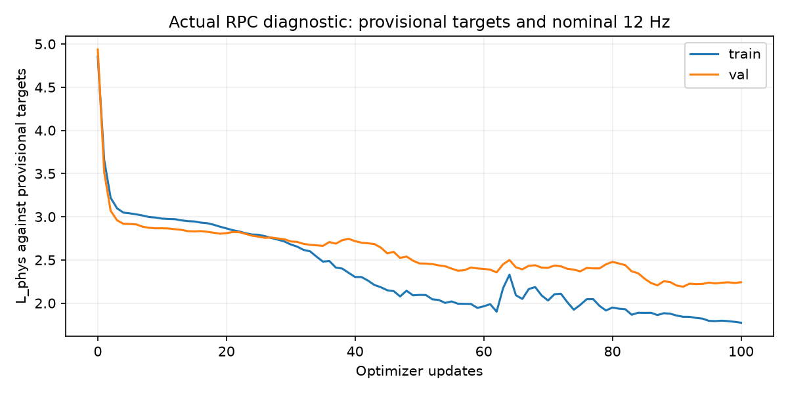

# Training diagnostik M4Human aktual

Run `diagnostic_20261026_05_complete`; status **passed**. RPC aktual, calon target direct joints, waktu nominal12Hz. G0 tetap false; hasil ini bukan akurasi penelitian yang disahkan.

| Tahap | Status |
|---|---|
| prepare | passed |
| physical | passed |
| alignment | passed |

**Varian eksperimen:** gain embedding sensor=0.026. Ini menyimpang dari input H langsung pada spesifikasi normatif; default arsitektur dan paket spesifikasi tidak diubah. Keberhasilan format bukan bukti gain ini meningkatkan grounding atau akurasi.

| Panel | L_phys awal | L_phys akhir |
|---|---|---|
| train | 4.855422 | 1.773253 |
| val | 4.936769 | 2.241553 |

100 optimizer updates; checkpoint dimuat ulang: True.

| Kondisi/kontrol | Optimizer updates | Schema valid rate pada val |
|---|---|---|
| M | 10 | 1.0 |
| S | 10 | 1.0 |
| F | 10 | 1.0 |
| E | 10 | 1.0 |
| R | 10 | 1.0 |
| T | 0 | 1.0 |
| Maj | 0 | 1.0 |
| Rule | 0 | 1.0 |

Hash parameter Qwen tetap sama: **True**.

Panel val hanya4 window. Label/kecepatan masih provisional; parser yang valid bukan bukti jawaban benar. Metrik numerik terhadap calon label tersimpan di alignment.json dan belum menjadi bukti generalisasi atau hipotesis riset.

Checkpoint per update dan optimizer berada di `C:\Users\Rio Aslab\Documents\ChatGPT\tugas akhir V2\checkpoints\m4human_relational64\fresh_20261026_01\diagnostic_runs\diagnostic_20261026_05_complete`.

Jika suatu tahap gagal, baca failures.jsonl, perbaiki, dan ulangi tahap itu. Jangan meluluskan gate ilmiah atau memakai checkpoint diagnostic untuk pemilihan test.
