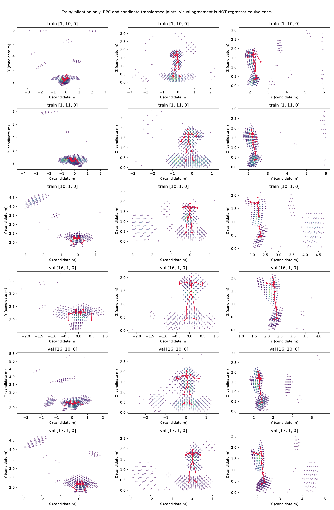
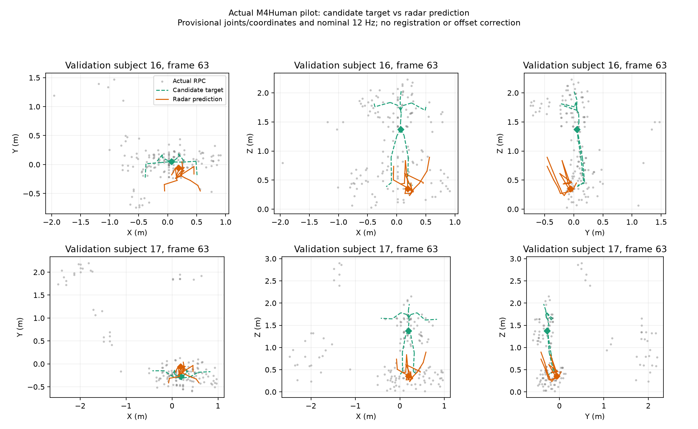
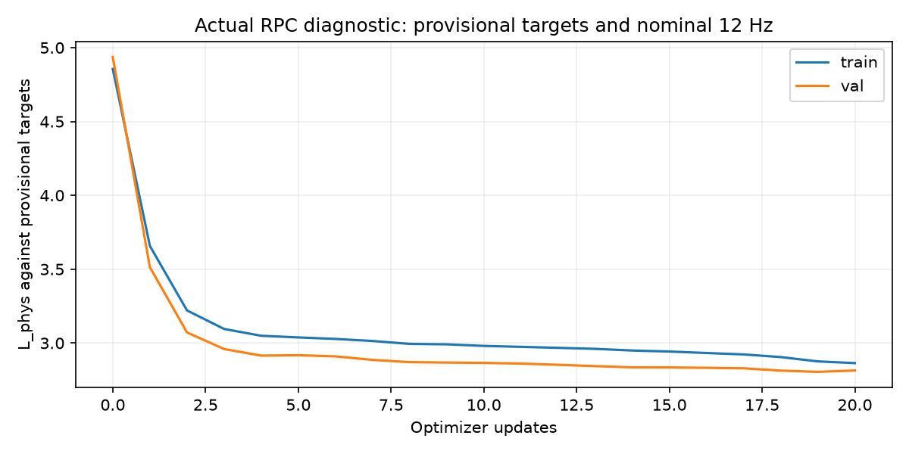

# Dokumentasi visual penelitian

Gambar berikut berasal dari audit dan pilot menggunakan **RPC M4Human aktual**.
Training diagnostik dijalankan pada Windows/CUDA RTX 3060. Semua contoh memakai
train/validation; target test tidak dibuka. Target joint dan transformasi masih
kandidat, waktu nominal 12 Hz masih provisional, serta G0 tetap false.

Gambar dipertahankan tanpa perubahan visual. [Manifest gambar](figures/fresh_20261026_01/manifest.json)
mencatat lokasi, resolusi, SHA-256, dan asal salinan audit. Penurunan loss,
kesesuaian visual, dan format jawaban yang valid memiliki batas interpretasi
yang berbeda; ketiganya belum mengesahkan akurasi penelitian.

## 1. Radar dan target koordinat kandidat

**Gambar 1.** Enam contoh sumber train/validation, masing-masing dalam proyeksi
XY, XZ, dan YZ. Warna titik mengikuti intensity; skeleton merah adalah direct
joints setelah transformasi kandidat Vicon–camera–radar. Intensity bukan
Doppler. Angka sumbu merupakan kandidat satuan meter.

Tumpang tindih skeleton dan wilayah tubuh mendukung kelayakan spasial pada
contoh ini. Gambar tidak membuktikan kesetaraan terhadap SMPL-X/regressor,
provenance sumbu/preprocessing RPC, atau sinkronisasi sumber. Salinan publikasi
memiliki hash identik dengan gambar audit lokal.

Sumber: [catatan pemeriksaan visual](report_training/fresh_20261026_01/coordinate_visual_check.json),
[otoritas dan keterbatasan data](data_authority.md).

## 2. Training fisik pilot lengkap

**Gambar 2.** `diagnostic_20261026_05_complete`: 100 update fisik pada 8 window
train dan 4 window validation awal, dengan target provisional. Biru menunjukkan
loss train, oranye menunjukkan loss validation. Loss train turun 4,855422 →
1,773253 atau 63,48%; loss validation akhir 2,241553.

Kurva mencatat kemampuan optimisasi pada panel kecil. Panel loss validation
empat window ini berbeda dari panel review yang diperluas menjadi 52 window.
Penurunan loss tidak menjamin pose atau jawaban QA telah akurat.

Sumber: [riwayat tiap update](report_training/fresh_20261026_01/diagnostic_runs/diagnostic_20261026_05_complete/physical_history.json),
[laporan training](report_training/fresh_20261026_01/diagnostic_runs/diagnostic_20261026_05_complete/report.md).

## 3. Prediksi pose dibanding radar dan calon target

**Gambar 3.** Frame 63 dari dua window validation, subjek 16 dan 17, ditampilkan
pada XY, XZ, dan YZ. Titik abu-abu adalah input RPC yang disampel untuk model;
garis hijau putus-putus merupakan calon target, garis oranye prediksi radar,
dan simbol berlian menandai pelvis. Posisi memakai meter setelah pengurangan
centroid window yang sama. Tidak diterapkan registration, Procrustes, atau
koreksi offset tambahan.

Prediksi masih terkompresi dan meleset dari calon skeleton, konsisten dengan
global MPJPE sekitar 0,997 meter pada keseluruhan panel validation. Dua contoh
ini merupakan diagnosis visual, bukan ringkasan statistik seluruh data.

Sumber: [identitas window dan hash gambar](report_training/fresh_20261026_01/diagnostic_runs/diagnostic_20261026_05_complete/reviews/validation12_v1/pose_visual_checks.json),
[metrik fisik lengkap](report_training/fresh_20261026_01/diagnostic_runs/diagnostic_20261026_05_complete/reviews/validation12_v1/physical_metrics.json).

## 4. Catatan run diagnostik sebelumnya

**Gambar 4.** `diagnostic_20261026_04_gain`: 20 update fisik, 8 window train dan
4 window validation. Loss akhir train 2,864122 dan validation 2,814121. Run ini
menggunakan gain 0,026 pada tahap alignment sebagai varian eksplisit dari
spesifikasi H langsung; gain tidak diterapkan pada objective fisik yang
ditampilkan dalam kurva.

Encoder fisik di-fit ulang untuk tiap run. Perbandingan kurva antar-run tidak
menjadi ablation kausal satu faktor atau bukti manfaat gain. Run awal beserta
kegagalan generation tetap tersedia di [temuan diagnostik](diagnostic_findings.md).

## Membaca gambar bersama hasil evaluasi

Pilot lengkap menghasilkan schema valid 100%, tetapi R belum mengungguli S atau
mayoritas dan PairBothCorrect donor masih 0/13. Tugas pelvis pada panel review
juga belum mencakup kelas `speeding_up` dan `slowing_down` yang reference-defined.
Gambar harus dibaca bersama [hasil pilot dan tindak lanjut](pilot_results.md),
bukan sebagai bukti keberhasilan hipotesis penelitian.
